<div align="center">

# ⚔️ Guerra Ezuberante

### Política, poderes absurdos e batalhas caóticas dentro do Minecraft.

**Seis facções · Personagens com IA · Exércitos invocáveis · Multiplayer**


**Ezuberante é com z. Esse é o nome do mod.**

</div>

Guerra Ezuberante é um projeto de mod de Minecraft Java Edition em que personagens caricatos inspirados em figuras públicas entram em combate com habilidades absurdas, invocações, transformações, músicas e exércitos próprios. Vamos começar com uma entidade simples funcionando e evoluir até guerras entre facções em um servidor com amigos.

Este README reúne o design do jogo, as tecnologias propostas, a arquitetura pretendida e o caminho de desenvolvimento. Os ataques, nomes de poderes e eventos pertencem a uma sátira fictícia de videogame.

📚 **[Guia de prompts](guia-de-prompts/README.md)** — como pedir personagens, poderes, correções e arte, com **[modelos para copiar](guia-de-prompts/MODELOS.md)**, **[requisitos para jogar/desenvolver](guia-de-prompts/REQUISITOS.md)** e **[instruções para modificar o mod](guia-de-prompts/COMO-MODIFICAR.md)**. A pasta tem seu próprio README e pode ser consultada diretamente no GitHub.

🤖 **[Manual completo para IAs colaboradoras — SKILL.md](guia-de-prompts/guerra-ezuberante/SKILL.md)** — um único arquivo para seus amigos anexarem às IAs deles, com regras de negócio, arquitetura, testes, criação de skins, áudio, vilas e contribuição.

> **Estado atual — 0.014.3.** A vila da **Missão** agora toca a música de batalha do Renan em loop enquanto o jogador permanece na área. A faixa usa o controle de volume **Música**, interrompe somente a trilha vanilla e preserva músicas de outros mods. O canal de facções usa o protocolo **4**, portanto cliente e servidor precisam estar atualizados juntos. Progressão, perfil **J**, cinco atributos, doze poderes, vozes do Jair, vilas com castelos e as correções da 0.014.2 continuam preservados. **B** usa o poder selecionado; **K** abre o painel. [Música da vila](docs/MUSICA_VILA_0.014.3.md) · [Correções e testes 0.014.2](docs/CORRECOES_0.014.2.md) · [Integração](docs/INTEGRACAO_0.014.1.md) · [Vilas](docs/VILAS_0.014.md).

## Música da vila da Missão — 0.014.3

Ao entrar na área completa de uma vila da Missão, incluindo casas, ruas e castelo, o cliente inicia `batalha.renan_santos` como música ambiente não posicional. A faixa continua até oito blocos além da borda para evitar cortes ao caminhar no limite e para imediatamente ao sair, morrer, entrar no modo espectador, trocar de dimensão ou desconectar.

A música vanilla é suspensa durante a faixa da vila; sons da categoria Música pertencentes a outros mods não são cancelados. A trilha respeita o slider **Música** e o modo de testes `-PsilentClient`. Somente a vila da Missão possui faixa nesta versão. [Implementação, instalação e validação](docs/MUSICA_VILA_0.014.3.md).

## Vilas de facção — 0.014.0


Mundos novos planejam **18 vilas**, **3 de cada facção**, em anéis com raio alvo de350–1.000 blocos do centro; a busca de bioma pode deslocar os pontos além dessa faixa. Cada uma usa casas do bioma, cores e estandartes da facção, praça e **castelo**. As vilas são o **único spawn natural** dos personagens, um de cada por vila, e **quem morre não volta**. Em mundos antigos, chunks já explorados não recebem a vila completa; use um mundo novo para conferir toda a geração.

| Facção | No castelo | Na vila | Bandeira |
| --- | --- | --- | --- |
| Lulista | Lula | — | vermelha com estrela branca |
| Bolsonarista | Jair | Flávio | verde com o mapa do Brasil em amarelo |
| Missão | Renan | Arthur | metade amarela, metade preta |
| Direita | trono vazio | — | azul com cifrão amarelo |
| Centro | trono vazio | — | cinza |
| Esquerda | trono vazio | — | vermelha com estrela amarela pequena |

Ao escolher a facção, o chat mostra as coordenadas das 3 vilas dela (clique copia). Elas também ficam no **painel K → Facções** e em `/ge vilas`. Mundos criados antes da 0.014 só ganham vila em áreas ainda não exploradas. Detalhes em [docs/VILAS_0.014.md](docs/VILAS_0.014.md).

## Vozes do Jair — 0.013.1

O Jair agora fala. **Botão direito** toca uma das gravações longas (Eu não te, Popcorn). **"Canalha"** só aparece quando ele **recebe dano**, com cerca de **40% de chance** (`[jair] canalha_chance`), nunca por cima de outra fala. Inventário e durações em [docs/AUDIOS.md](docs/AUDIOS.md).

## Nível, status e poderes de Convicção — 0.013.0


- **Tecla J** abre o perfil: nível (até 30), barra de XP, pontos livres, os cinco status com botão **+** e os três poderes da facção. Clicar num poder liberado faz dele o poder da **B**.
- **XP por abates**: mob hostil 10, personagem do mod 40, boss 200, jogador de outra facção 60. Abates feitos com poderes e pelas suas tropas contam. 1 ponto por nível, até 10 por status.
- **Status**: Força (+0,5 de dano corpo a corpo), Velocidade (+2%), Vida (+1), Força Ideológica (+5% no dano dos poderes) e Convicção Ideológica (−2% de recarga; **5 libera o 2º poder, 10 libera o 3º**).

| Facção | 2º poder | 3º poder |
| --- | --- | --- |
| Lulista | Fim da Escala! (pisão com onda de choque) | Faz o L (L gigante com a explosão da morte do Lula; quem sobrevive perde 2 itens) |
| Bolsonarista | Histórico de Atleta (Força, Velocidade, Pressa, Salto e Vida) | Não Sou Coveiro (cova 10 × 5 × 5, 10 de dano) |
| Missão | Aborto Zacarias (chuva de pedras rosas) | O Livro Amarelo (livros que deixam o alvo Entediado) |
| Esquerda | Manifestando (10 zumbis vermelhos que agem como lobos) | Greve Geral (Lentidão II e Fraqueza em área) |
| Direita | Salto Liberal (salto com impacto) | Mão Invisível (empurrão com dano) |
| Centro | Isenção (Resistência IV) | Toma Lá, Dá Cá (drena vida dos inimigos) |

Operadores: `/ge nivel xp <jogadores> <quantidade>` e `/ge nivel resetar <jogadores>`. Detalhes, números e configuração em [docs/PROGRESSAO_0.013.md](docs/PROGRESSAO_0.013.md).


> **Integração anterior — 0.012.1.** Escolha persistente, prefixos, poderes, passivos e kits criados por GabrielKraemer2805. As correções de PvP das tropas, limpeza após morte/desconexão e recuperação após relog continuam preservadas. [Detalhes](docs/INTEGRACAO_FACCOES_0.012.1.md).

## Facções, poderes e kits — 0.012.0

| Quando | O que acontece |
| --- | --- |
| Primeiro login | Tela **Escolha sua facção**; clicar mostra a descrição, **Entrar na facção** confirma. |
| Decidir depois | Painel K → Facções → **Escolher facção**; a tela volta no próximo login. |
| Depois da escolha | Prefixo `[Lulista]`, `[Bolsonarista]`, `[Missão]`, `[Esquerda]`, `[Direita]` ou `[Centro]`; escolha salva ao sair, morrer ou trocar de dimensão. |
| Operador | `/ge faccao definir <jogadores> <faccao>` e `/ge faccao limpar <jogadores>`; qualquer jogador consulta com `/ge faccao`. |

| Facção | Poder (B) | Passivo | Kit inicial |
| --- | --- | --- | --- |
| Esquerda Lulista | Chuva de Feijão: 3 feijões, 5 de dano cada (8 s) | Picanha: +50% de saturação | 8 bifes e 16 pães |
| Direita Bolsonarista | Rachadinha: fenda de 8 blocos, 8 de dano, sem escavar (15 s) | Colete: +2 de armadura | GE-P12 carregada e 24 cartuchos |
| Direita Missão | Exército Ucraniano: 2 Combatentes por 30 s (45 s) | Disciplina: +2 de vida máxima | Espada Ucraniana e escudo |
| Esquerda Independente | Cura em Grupo: Regeneração II em 6 blocos (30 s) | Recuperação: 1 de vida a cada 4 s fora de combate | Escudo, peitoral de ferro e 2 poções de cura |
| Direita Independente | Investida: impulso frontal e Força I (12 s) | Agilidade: +10% de velocidade | Arco com Poder I e 32 flechas |
| Centro | Adaptação: Defesa ↔ Mobilidade (5 s) | Postura sempre ativa | Espada de ferro, escudo e 8 bifes |

O kit sai uma única vez por jogador por mundo. A facção não bloqueia dano entre membros nem muda o comportamento dos personagens com IA. Valores na seção `[faction_powers]` da configuração do servidor.

> **Versão anterior — 0.011.0.** Lula e Jair têm **300 HP, como o Wither**, com barras de boss **Lula em vermelho** e **Jair Bolsonaro em verde**. Flávio repete a **Rachadinha a cada 6 segundos** durante o combate: **10 de dano**, mais knockback e impacto final com raio de **2,25 blocos**. [Detalhes da atualização](docs/BOSSES_0.011.md), [Jair e Flávio](docs/JAIR_FLAVIO_0.010.md), [validação](docs/VALIDACAO.md).

## Vida de boss e Rachadinha recorrente — 0.011.0

| Personagem | Vida padrão | Barra no topo da tela |
| --- | --- | --- |
| Lula | 300 HP / 150 corações | **Lula**, vermelha |
| Jair Bolsonaro | 300 HP / 150 corações | **Jair Bolsonaro**, verde |
| Flávio Bolsonaro | 30 HP / 15 corações | Sem barra de boss |

As barras usam o sistema nativo do Minecraft: aparecem ao rastrear o personagem, acompanham a vida atual e desaparecem na morte ou ao sair do alcance. Personagens já salvos com o antigo padrão de 30 HP recebem 300 HP mantendo a porcentagem de vida. Configurações personalizadas são preservadas.

O ataque especial do Flávio tem prioridade sobre os socos quando a recarga termina. Ele volta a golpear o chão enquanto houver um alvo válido e visível, inclusive bem perto; continua neutro fora do combate. O impacto final tem partículas e som mais fortes e atinge inimigos numa área maior, mantendo **um dano por alvo por ativação**, sem atingir aliados ou animais alheios à luta.

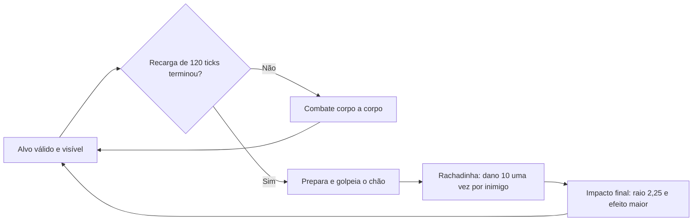

O projeto segue o desafio de desenvolvimento **100% por IA**. Código, UVs, modelos, keyframes, conversões, validações e correções são responsabilidade do agente. O autor fornece ideias, assets e feedback; não precisa configurar Blockbench ou editar Java/JSON.

> **Correção visual0.010.1:** laterais das cabeças de Jair e Flávio retocadas para diminuir a aparência das orelhas e preencher o cabelo do Jair. Rosto, roupas e faixa preservados pixel a pixel. [Procedência e detalhes](docs/arte/correcao-cabecas-0.010.1.md). Mecânicas da0.010.0 mantidas.

## Jair, Flávio e Rachadinha — 0.010.0


| Tecnologia existente | Uso nesta sprint | Motivo |
| --- | --- | --- |
| **TaCZ 1.1.8-hotfix2** | Glock 17 original, projéteis, modelo3D, som e dano | Mantém o arsenal já integrado; não copia assets nem instala outro mod de armas |
| **Forge 1.20.1 / Java 17** | IA, cooldowns, invocações, dano e escavação | Servidor decide todas as ações; o cliente não aplica dano |
| **GeckoLib 4.8.4** | Dois modelos, quinze clipes e arma presa à mão | Preserva as skins64×64 e usa keyframes sincronizados |
| **SynchedEntityData / NBT / SavedData** | Fase visual, vínculo do dono, cooldowns e limite de aliados | Evita duplicação e mantém contagem mesmo com unidades descarregadas |
| **Renderização e efeitos vanilla** | Rachadura desenhada no chão, partículas e sons de impacto | Cria uma fissura estreita sem explodir crateras circulares em cada segmento |

### Personagens e como testar

| Entidade | ID | Comportamento padrão |
| --- | --- | --- |
| Jair Bolsonaro | `guerra_ezuberante:jair_bolsonaro` | Neutro, 300 HP e barra verde, Glock 17 e Dinastia Bolsonaro; morte verde |
| Flávio Bolsonaro | `guerra_ezuberante:flavio_bolsonaro` | Neutro independente ou aliado vinculado ao Jair; Rachadinha e corpo a corpo |

Skins originais preservadas por hash, modelos separados e ovos na aba Guerra Ezuberante. **K → Personagens → Jair / Flávio** abre informações e prévia. Os previews grandes enviados pelo autor não são usados como textura.

```mcfunction
/give @s guerra_ezuberante:jair_bolsonaro_spawn_egg
/give @s guerra_ezuberante:flavio_bolsonaro_spawn_egg
```

Provoque em Survival para observar combate. Nenhuma identidade política gera agressão automática a jogadores. Jair e Flávio são aliados entre si; demais relações existentes foram preservadas.

### Glock 17 e Dinastia Bolsonaro

A pistola é **`tacz:glock_17`**,9mm, SEMI. Usa o disparo, bala, som e dano originais. O NPC não gasta munição nem precisa recarregar; a regra pertence ao operador Jair, sem tag de munição infinita no item e sem mudar a pistola dos jogadores. Sem TaCZ, usa fallback desarmado.

Mira por12 ticks e solicita um tiro a cada **20 ticks**, sem rajada nem acúmulo por lag. Mantém distância útil5–18 blocos e interrompe quando parede ou aliado bloqueia o corredor. O tiro não é gerado pela animação.

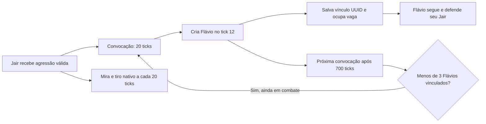

Padrão: **1 Flávio a cada 35 segundos, limite3 por Jair**. Os números são configuráveis. A contagem inclui unidades descarregadas. Ao morrer/remover Jair, suas invocações são descartadas; unidades independentes criadas por ovo continuam independentes. Dono ausente tem tolerância de200 ticks carregados, seguindo a política existente.

### Rachadinha: o solo se abre em direção ao alvo

Flávio ergue os braços e o joelho por8 ticks, golpeia o chão no **tick10** e recupera a postura até o24. A fissura avança depois, uma célula a cada3 ticks, com pequenos desvios laterais, partículas do terreno, decal de rachadura e impacto final mais forte.

Padrão atual: **alcance 8 blocos, largura aproximada 1, cooldown 6 s, até 10 de dano base por alvo por ativação, knockback 0,65 e raio final 2,25 blocos**. Um conjunto de UUIDs impede que os segmentos repitam o dano. Golpes corpo a corpo são ataques separados. Aliados, dono e animais sem relação com o combate não são vítimas da área. A prioridade da habilidade permite repetir a Rachadinha durante a luta, mesmo depois de iniciar os socos.

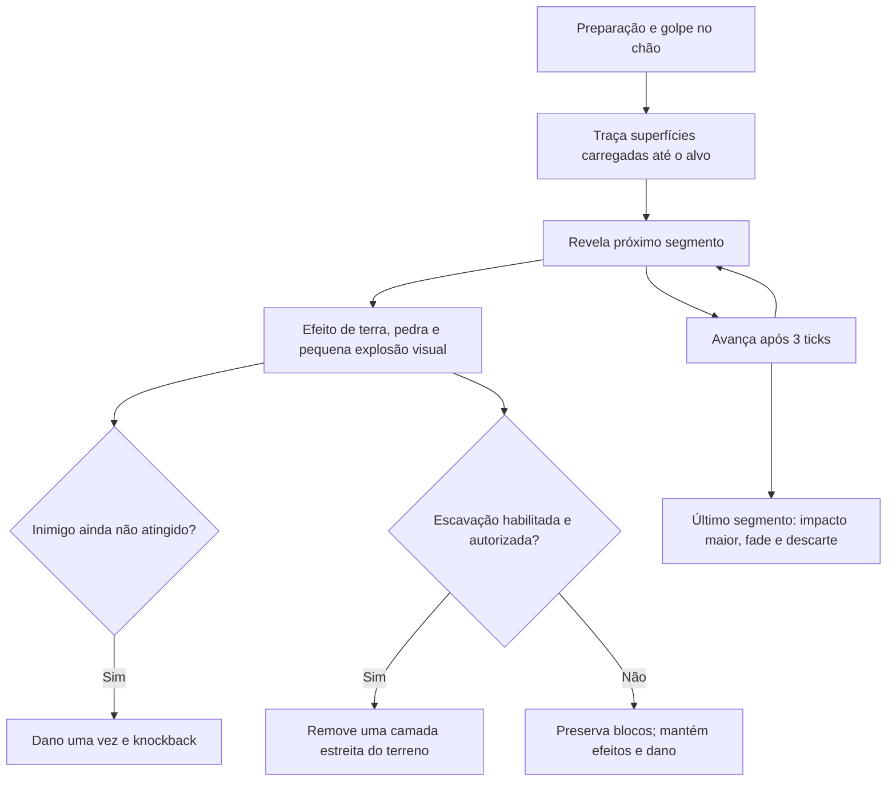

O percurso acompanha degraus e para diante de parede alta, falta de chão, borda ou chunk ausente. Não força carregamento. A remoção real atinge uma faixa estreita de blocos naturais permitidos, sem TNT e sem explosão circular destrutiva por segmento. Bedrock, containers e materiais fora da lista são preservados.

`mobGriefing`, `canEntityDestroy`, **LivingDestroyBlockEvent** e **BlockEvent.BreakEvent** podem negar a escavação. O evento de bloco usa um FakePlayer próprio em Survival, sem OP, sem emprestar a identidade do autor. A compatibilidade foi verificada com cancelamentos dos hooks Forge; mods de proteção com APIs próprias podem exigir integração específica.

### Morte verde e sistema compartilhado com Lula

`SpecialDeathEntity` reúne os estados **ALIVE → DYING → EXPLODED**, salvamento, subida e explosão única. A compatibilidade dos campos NBT antigos do Lula foi mantida. Jair usa a mesma sequência60 ticks: ganha tint verde, sobe2 blocos, curva corpo/cabeça, dobra braços/joelhos, treme e explode. Partículas verdes/amarelas distinguem a morte do vermelho do Lula.

Potência **7**, sem fogo, conferida no surgimento do Wither official1.20.1. Dano, exposição, knockback e som vêm da explosão nativa, respeitando as opções de blocos e hooks. Jair interrompe tiros/invocações e remove suas unidades vinculadas. Cada entidade explode no máximo uma vez; salvar/carregar não reinicia a sequência.

### Configuração, sons e documentação

No arquivo SERVER do mundo, as seções **`[jair]`** e **`[flavio]`** centralizam atributos, limite/cooldown de convocação, morte verde e Rachadinha. Para preservar terreno, use `jair.death_explosion_block_damage=false` e `flavio.rachadinha_block_damage=false`; `mobGriefing=false` também impede essas destruições. O padrão permite dano real a blocos; use um mundo descartável para testar.

Não foram encontrados áudios próprios dos dois personagens. Nenhuma fala foi inventada; a Glock usa TaCZ e a fissura usa efeitos vanilla de pedra/explosão. Playlists antigas permanecem intactas.

[Documentação completa: configurações,15 animações, arquivos, testes e limitações](docs/JAIR_FLAVIO_0.010.md).

**Validação real:** build/reobf e **71 GameTests aprovados**, mais **12 testes sem TaCZ**. Dois clientes reais confirmaram a Glock, o aliado, a fissura e as mortes coloridas. Foram 21 disparos medidos com intervalo 20/20 e carregador17→17; cada fissura controlada causou6 de dano uma vez, com0 blocos removidos no modoOFF e11 no modoON. [Relatório host](docs/validacao/bolsonaro-0.010/host.json) · [Relatório observador](docs/validacao/bolsonaro-0.010/observer.json). Testes silenciosos e mundos isolados; limites detalhados na documentação.


## Lula, feijões e morte explosiva — 0.009.0


| Tecnologia | Uso no Lula e motivo |
| --- | --- |
| Java 17 / Forge | Entidade, atributos, goal de distância e configurações do servidor; reutiliza a base existente |
| Física vanilla | `ThrowableItemProjectile` cuida de voo e colisão; `Level.explode` aplica dano, exposição e knockback reais |
| GeckoLib 4.8.4 | Modelo próprio articulado, barriga saliente, respiração, caminhada, arremesso, dano e morte; nenhum plugin novo |
| `SynchedEntityData` / NBT | Servidor transmite fase/relógio e salva progresso; clientes fazem tint e animação sem decidir dano |
| FFmpeg / FFprobe | Converte gravações recebidas sem cortes e mede timers exatos; originais preservados |
| GameTest / cliente real | Testes de lógica e proteção de mundo separados da inspeção gráfica e de rede |

Lula nasce neutro com **300 HP e barra vermelha de boss**, velocidade base **0,23** e hitbox **0,6 × 1,8**. O ovo `guerra_ezuberante:lula_spawn_egg` aparece na aba do mod. **K → Personagens → Lula** mostra detalhes, disponibilidade das falas e prévia. A skin 64×64 fornecida foi copiada sem alteração; a barriga tem três volumes extras e acompanha o torso.

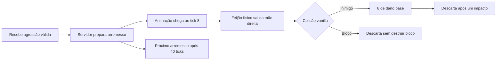

O feijão usa sprite marrom original **16×16**, gravidade, autoria e tempo máximo de vida de 100 ticks. Não acerta instantaneamente: o alvo pode se mover e esquivar. Dono e aliados de scoreboard são ignorados. Dano a entidades acontece somente no servidor, sem golpe corpo a corpo concorrente. A soltura também verifica alvo e linha de visão; parede ou morte cancela o projétil pendente.

### A sequência de morte

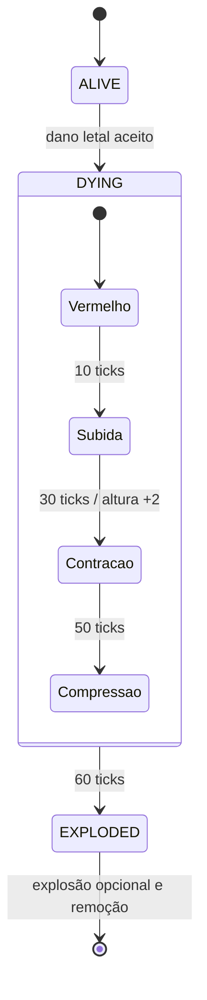

O servidor interrompe IA, perseguição, ataques e música. O modelo inteiro ganha tint vermelho persistente, sobe com interpolação suave e curva tronco/cabeça, cotovelos e joelhos. Nos últimos dez ticks, compressão, tremor e partículas vermelhas antecipam a explosão. A queda e o desaparecimento vanilla após 20 ticks foram substituídos pelo relógio da sequência.

A potência foi conferida no `WitherBoss` **official 1.20.1** do JAR efetivamente usado: **7.0F, sem fogo, interação MOB** ao terminar o surgimento. Lula chama a explosão nativa no centro do corpo após a subida. `mobGriefing` e eventos Forge continuam aplicáveis. Cada entidade marca EXPLODED antes da chamada, explode no máximo uma vez e é descartada. Lulas atingidos letalmente podem iniciar outras sequências de três segundos, sem explosão recursiva imediata.

Salvar/carregar durante DYING retoma o progresso carregado restante; não reinicia a animação. Um estado EXPLODED carregado é removido sem nova explosão. Dano adicional não reinicia a morte.

### Áudio e configuração

Quatro originais encontrados em **`audios/lula_audio/`**, todos preservados: `feijao puro.MP3` (9,25 s), `lula homofobia.MP3` (5,43 s), `lula machiso.MP3` (7,29 s) e `luluaracismo.MP3` (7,78 s). OGGs mono 44,1 kHz são distribuídos em `sounds/lula/`. Os nomes identificam arquivos recebidos. A mesma playlist atende botão direito e combate, com shuffle bag e uma instância espacial por entidade. Não foi atribuída fala temática de morte/dano sem identificação adequada.

No arquivo SERVER do mundo, `serverconfig/guerra_ezuberante-server.toml`:

```toml
[lula]
max_health = 300.0
death_explosion_enabled = true
death_explosion_power = 7.0
death_animation_ticks = 60
death_rise_blocks = 2.0
death_explosion_block_damage = true
```

`death_explosion_block_damage=false` preserva os blocos mantendo dano a entidades e efeitos; `mobGriefing=false` também protege blocos. `death_explosion_enabled=false` mantém a animação e remoção, sem explosão. A configuração é capturada no início da morte. O padrão pode destruir terreno; teste a morte em um mundo descartável.

**Validação:** 60 GameTests passaram, incluindo dano 6 por impacto, cadência exata, windup, parede, vida útil, neutralidade, aliados, subida, retomada NBT, blast único de potência 7, knockback, opções de blocos, `mobGriefing`, cadeia e cancelamento por proteção Forge. Os cenários gráficos usam clientes reais em perfis isolados com **volume mestre zero**, sem modificar o volume do perfil normal. Detalhes, relatórios e limites em [LULA_0.009.md](docs/LULA_0.009.md).

**Dois clientes reais passaram:** host e observador receberam os mesmos cinco feijões, as quatro gravações com uma instância por entidade, o tint progressivo, a pose articulada, a subida de 2 blocos e um som nativo de explosão. [Relatório host](docs/validacao/lula-0.009/host.json) · [Relatório remoto](docs/validacao/lula-0.009/observer.json). Houve timeout de login numa tentativa anterior; o teste local final não equivale a validar internet pública ou alta latência.


```mcfunction
/give @s guerra_ezuberante:lula_spawn_egg
/summon guerra_ezuberante:lula ~ ~ ~5
```

O design de facções e dos poderes adicionais mais abaixo continua como planejamento; esta sprint implementa especificamente o comportamento descrito nesta seção.

## Tela inicial ilustrada — 0.008.0

Uma arte criada com **imagegen** reúne Renan em destaque, Lula, Flávio Bolsonaro, Donald Trump, Benjamin Netanyahu e Xi Jinping em cenário voxel de batalha, com o título do mod. Os personagens extras são elementos da ilustração; não foram implementados como mobs nesta sprint.


Singleplayer, Multiplayer, Minecraft Realms, Mods, Options, Quit, Language e Accessibility continuam sendo os controles originais. A classe estende `TitleScreen` e substitui somente a apresentação do panorama; o logo e a frase amarela são ocultados porque o título já está na arte. Nenhum widget foi recriado.

O fundo preenche a tela sem distorcer, com recorte proporcional e escurecimento inferior suave. O PNG está em `src/main/resources/assets/guerra_ezuberante/textures/gui/title/guerra_ezuberante_menu_bg.png`. [Código, prompt utilizado, capturas 4:3/ultrawide, testes e troca futura da imagem](docs/MENU_0.008.md).

## Renan armado e playlists — adicionados na 0.007.0

Renan continua pacífico até ser provocado. Com TaCZ instalado, nasce segurando a AK-47 real, usa o pipeline nativo de projéteis/dano e atira **uma bala por 20 ticks de servidor**, depois da preparação inicial. Mantém distância, exige linha de visão e protege aliados. A munição infinita pertence ao operador do NPC; a arma dos jogadores continua com munição e recarga normais. Sem TaCZ, permanece disponível o combate básico desarmado.

O modelo e a skin foram preservados. Seis clipes GeckoLib acrescentam idle armado, preparação, mira, caminhada, disparo/recuo e reação a dano. As variantes de Arthur, tropas, espada, controles das armas e a GE-P12 permanecem.

**Áudio conforme a orientação atual do autor:** três gravações do Renan e sete gravações únicas do Arthur entram nas respectivas playlists, incluindo falas e músicas. Uma shuffle bag toca todas antes de repetir, evita repetir entre rodadas e escolhe a primeira sem ordem fixa. Cópias idênticas dos arquivos não viram faixas duplicadas. O efeito de invocação continua no evento de conjuração.

| Ativação | Comportamento |
| --- | --- |
| Entrada em combate | Inicia a playlist ou mantém a faixa já ativa |
| Botão direito direto na entidade | Inicia ou avança para a próxima; cooldown de 0,5 s |
| Fim da gravação | Avança se a sessão continua ativa |
| Fim de combate/sessão manual | Termina a gravação atual e para |
| Morte, remoção ou perda da entidade no cliente | Encerra a reprodução associada |

A música acompanha a posição da entidade, com atenuação local, streaming e no máximo uma instância por personagem em cada cliente. Não altera o botão direito usado para ADS. Configuração `character_audio` do mundo permite ajustar volume e duração da sessão. [Durações auditadas, arquitetura, fontes e limites](docs/RENAN_0.007.md).

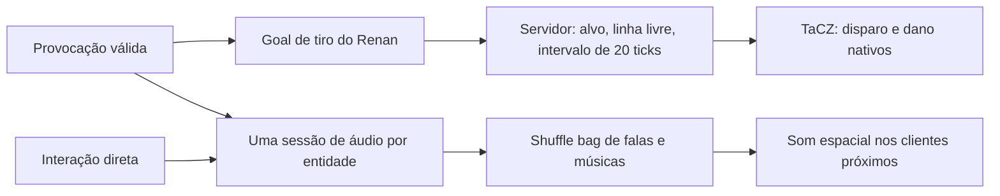

[Próximos personagens — Lula](docs/PROXIMOS_PERSONAGENS.md) registra requisitos a definir pelo autor. Lula não foi implementado e não recebeu habilidades inventadas.

Validação desta entrega: **54 GameTests**, **11 testes sem TaCZ** e duas sessões gráficas prolongadas aprovadas. No teste de dois clientes, o Renan produziu124 tiros/projéteis/acertos e o observador recebeu124 eventos remotos, com mira/recuo e playlist sincronizados. [Relatórios e limites](docs/VALIDACAO.md). As instâncias automatizadas agora sempre iniciam com som zerado, conforme a preferência do autor.

## Pistola própria GE-P12 — adicionada na 0.006.0

Protótipo para avaliar um sistema independente de armas. O item `guerra_ezuberante:ge_p12` usa um modelo tridimensional original de cubos, desenhado por código, e três sons gerados por síntese. Não utiliza classes, gunpacks, modelos, animações ou áudios do TaCZ.

| Característica | Implementação |
| --- | --- |
| Disparo | Semiautomático; botão esquerdo, um tiro por pressionamento |
| Mira | Segurar botão direito; transição ao centro e redução de FOV em 22% |
| Recarga | **R**, 32 ticks / 1,6 s; trocar de slot cancela sem consumir reserva |
| Carregador | 12 cartuchos; munição própria `guerra_ezuberante:pistol_ammo` |
| Cadência | Intervalo mínimo de 6 ticks / 0,3 s, validado no servidor |
| Dano | 6 HP antes da armadura; hitscan até 48 blocos, bloqueado por paredes |
| Kit de teste | **`/ge pistola`**, exige OP 2: pistola carregada + 48 cartuchos |
| Acesso criativo | Pistola e cartuchos na aba Guerra Ezuberante; pistola nova vazia, R carrega |
| NPCs | Nenhum recebe a pistola automaticamente |

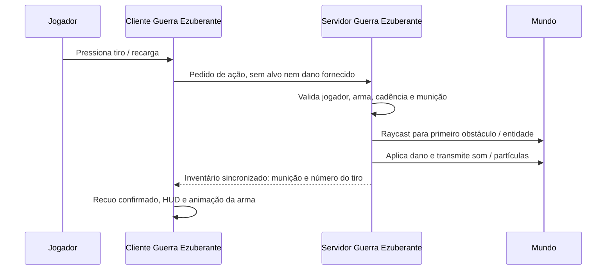

Mira, recuo e animação de recarga deste protótipo são simples; ainda não há mãos articuladas, carregador animado separado, acessórios ou receitas Survival. São recursos para uma possível próxima etapa, não uma substituição completa do TaCZ. O suporte anterior continua disponível quando ele está instalado; cada sistema atua somente em seus próprios itens.

O build gera também **`build/distributions/guerra-ezuberante-0.014.3-sem-tacz/mods/`**, com Guerra Ezuberante e GeckoLib. A GE-P12 não adiciona outro mod na lista. **GeckoLib ainda aparece separadamente**, pois os personagens dependem dele. Para preservar armas já salvas, o perfil normal de desenvolvimento mantém TaCZ; os testes de independência usam um mundo isolado sem ele.

**Validação executada:** 47 GameTests com TaCZ e 10 próprios sem ele. Os dois cenários gráficos passaram: modelo 3D, ADS/FOV, tiro e dano, som único, recoil, recarga/conservação, gatilho segurado sem rajada e rejeição sem munição. A aba criativa real abriu com 6 itens sem TaCZ e 15 com ele. Multiplayer gráfico entre dois clientes da GE-P12 ainda não foi testado.

[Detalhes, capturas e testes](docs/PISTOLA_0.006.md).

## Arsenal opcional TaCZ — integrado na 0.005.0

Quando o TaCZ está instalado, o Guerra Ezuberante adiciona seus **itens reais** à aba criativa usando a API externa. O TaCZ controla o funcionamento dessas cinco armas; a GE-P12 tem uma implementação própria e independente. Nenhum personagem político recebe armas automaticamente.

| Arma | ID no gunpack oficial | Munição | Comando administrativo | Reserva do kit |
| --- | --- | --- | --- | --- |
| AKM / AK-47 | `tacz:ak47` | `tacz:762x39` — 7,62×39 | `/ge armamento ak47` | 120 |
| M4A1 | `tacz:m4a1` | `tacz:556x45` — 5,56×45 | `/ge armamento m4a1` | 120 |
| Glock 17 | `tacz:glock_17` | `tacz:9mm` — 9 mm | `/ge armamento glock17` | 68 |
| Desert Eagle | `tacz:deagle` | `tacz:50ae` — .50 AE | `/ge armamento deagle` | 64 |
| MP5A5 | `tacz:hk_mp5a5` | `tacz:9mm` — 9 mm | `/ge armamento mp5` | 120 |

Os kits entregam uma arma carregada, sem acessórios obrigatórios, e munição compatível separada em pilhas válidas. Reserva = quatro carregadores padrão, com mínimo de 64 cartuchos. O comando exige **permissão de operador nível 2** e um jogador como executor; não concede armas livremente em servidores Survival. Também aceita `akm`, `glock_17`, `hk_mp5a5` e `mp5a5`. Tab completa os nomes principais.

Na aba **Guerra Ezuberante**, os quatro itens existentes foram mantidos e acompanhados por cinco armas e quatro entradas de munição; 9 mm aparece uma vez, compartilhado pela Glock e pela MP5. Os identificadores acima são índices do gunpack, não novos itens registrados pelo Guerra Ezuberante. Por isso a integração usa `GunItemBuilder`/`AmmoItemBuilder`, em vez de tentar um `/give` de um item inexistente com o mesmo nome.

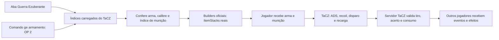

### Controles originais

| Ação | Padrão do TaCZ |
| --- | --- |
| Disparar | Botão esquerdo |
| Mirar / ADS | Botão direito; segue o modo de mira configurado no TaCZ |
| Recarregar | **R** |
| Alternar modo de tiro | **G**, conforme os modos da arma |
| Inspecionar | **H** |
| Acessórios | **Z**, usando a interface original |
| Painel do Guerra Ezuberante | **K**, preservado |

Os controles podem ser remapeados no Minecraft. A integração não registra teclas concorrentes nem altera os valores de dano/tempo do gunpack. Um teste com óptica nativa confirma que acessórios continuam instaláveis; as cinco armas funcionam sem eles.

### Dependências e instalação

| Componente | Versão validada | Necessidade |
| --- | --- | --- |
| Minecraft Java | 1.20.1 | Plataforma |
| Forge | 47.4.28 | Cliente e servidor |
| Java | 17 | Jogo e desenvolvimento |
| Guerra Ezuberante | 0.014.3 | Este mod, inclui menu ilustrado, Renan armado, GE-P12 e música da vila da Missão |
| GeckoLib | 4.8.4 para Forge 1.20.1 | Personagens e animações existentes |
| TaCZ | **1.1.8-hotfix2**, arquivo CurseForge **9037989** | Opcional; necessário nos dois lados para usar as cinco armas nativas |

O build prepara os três JARs separados em **`build/distributions/guerra-ezuberante-0.014.3/mods/`** e a alternativa sem TaCZ em **`build/distributions/guerra-ezuberante-0.014.3-sem-tacz/mods/`**. O artefato próprio fica em **`build/libs/guerra_ezuberante-0.014.3.jar`**. Cliente e servidor devem usar o mesmo conjunto. O gunpack padrão já vem no JAR oficial do TaCZ; a GE-P12 não precisa dele.

A dependência foi fixada pelo [arquivo oficial publicado em 02/10/2026](https://www.curseforge.com/minecraft/mc-mods/timeless-and-classics-zero/files/9037989), não pelo exemplo antigo 1.1.6 do README do TaCZ. Gradle usa CurseMaven com `fg.deobf`; o pacote local utiliza o JAR original, sem o remapeamento de desenvolvimento. `mods.toml` exige a versão exata. `validateTacz` verifica SHA-256 e os IDs/calibres no gunpack dessa distribuição.

Créditos: **Serene Wave Studio | Timeless Squad**. O projeto TaCZ declara código GPL 3.0 e assets CC BY-NC-ND 4.0; seus arquivos permanecem na distribuição externa original. Não foram copiados modelos, texturas, animações ou sons para nosso repositório. [Fontes, versões e créditos](docs/DEPENDENCIAS_TERCEROS.md).

### Testes do arsenal

Além dos 37 GameTests, a automação abriu o Minecraft, criou um cenário isolado em Survival e usou a API cliente real do TaCZ. Mediu ADS/FOV, recoil de câmera, um som por tiro, dano real no alvo, carregador, recarga e tentativa sem munição. Depois repetiu as cinco armas em servidor dedicado: o Observer recebeu um tiro e uma recarga de cada arma, e o servidor confirmou conservação de munição e um acerto por disparo. [Evidências, capturas e limites](docs/ARSENAL_0.005.md).

```powershell
# Desenvolvimento no IntelliJ / terminal, com JDK 17 e dependências resolvidas pelo agente
powershell -NoProfile -ExecutionPolicy Bypass -File tools/gradle.ps1 runClient
powershell -NoProfile -ExecutionPolicy Bypass -File tools/gradle.ps1 runGameTestServer build

# Teste gráfico isolado; encerra apenas a sua própria instância de teste
powershell -NoProfile -ExecutionPolicy Bypass -File tools/arsenal_visual_test.ps1

# Servidor dedicado e dois clientes em localhost; requer aceite explícito prévio da EULA
powershell -NoProfile -ExecutionPolicy Bypass -File tools/arsenal_network_test.ps1
```

Os perfis automatizados ficam em `.tools/`; o mundo habitual em `run/` não é usado nesses cenários. O autor aceitou a EULA para o teste local desta sprint. Ao finalizar uma versão, o agente abre o perfil normal atualizado e deixa o Minecraft aberto para o autor testar. Nenhum push ou merge está autorizado nesta sprint.


<details>
<summary>Ver AKM em primeira pessoa, ADS e recarga</summary>


</details>

As capturas são do Minecraft real. Os testes funcionais de uma sessão dedicada com dois clientes passaram; tentativas posteriores de login tiveram timeout, portanto a repetibilidade de conexão ainda é pendente. Também há avisos do TaCZ sobre referências de áudio ausentes em alguns keyframes e em um arquivo agregado de recarga. A integração preserva a distribuição original e não inventa assets substitutos.

## Dois Arthurs, uma implementação

| Personagem | Equipamento ao nascer | Habilidade | Movimento |
| --- | --- | --- | --- |
| Arthur do Val — Combatente | Espada Ucraniana | Não invoca; usa golpes de espada | Base 0,24; sem Velocidade por invocação |
| Arthur do Val — Invocador | Sem arma | Conjura até cinco tropas por leva | Base 0,24; Velocidade I infinita após primeira leva bem-sucedida |
| Arthur antigo (`arthur_do_val`) | Sem arma | Preservado como Invocador para compatibilidade | Mesma regra do Invocador |

Os dois novos ovos ficam na aba Guerra Ezuberante. A entidade e o ovo antigos continuam registrados, mas o ovo legado não ocupa espaço na aba. Ambos mantêm 32 HP, atributo básico de dano 5, escala 0,88, hitbox 0,528 × 1,584 e as falas existentes. O Arthur Combatente mantém **5 HP de dano final**: seu cálculo de ataque exclui o modificador da arma para preservar o balanceamento pedido. O item continua idêntico a uma espada de ferro, e as tropas continuam com dano total 6.

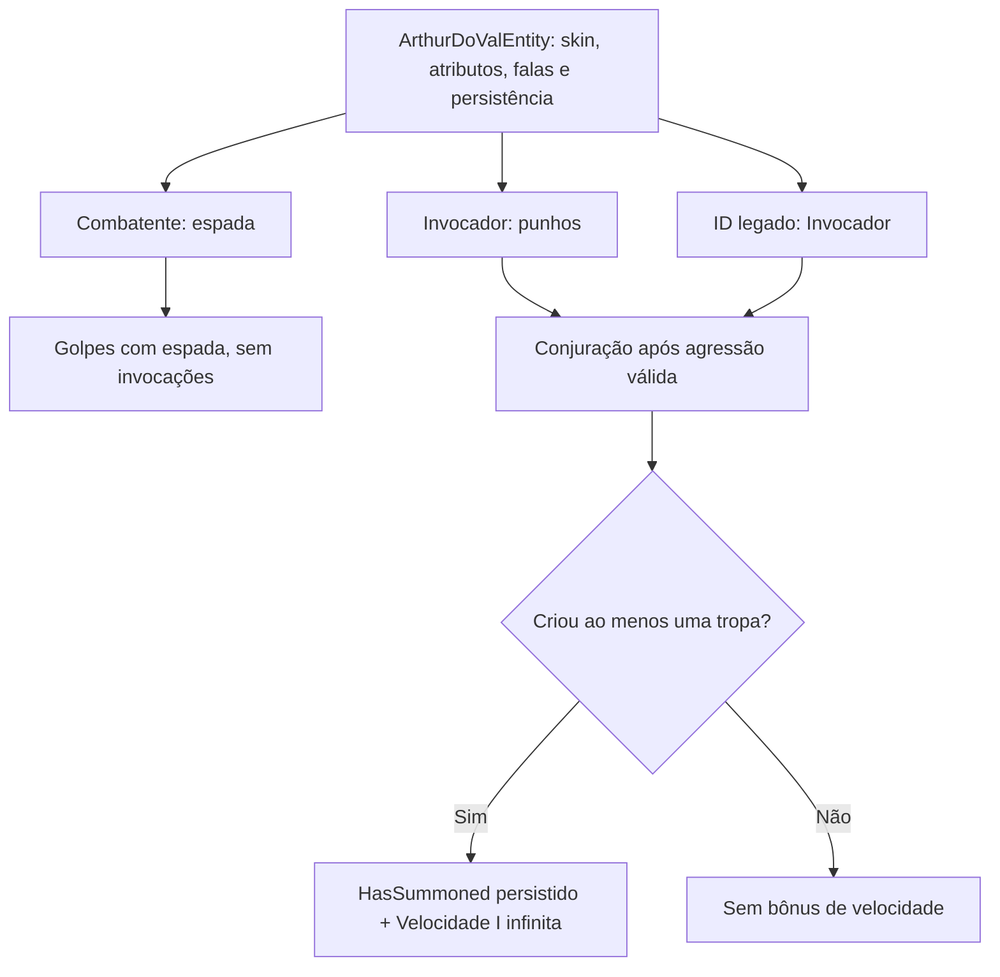

## Modelos e animações gerados por IA

`tools/GenerateGeckoAssets.java` gera `geo/humanoid.geo.json` e `animations/humanoid.animation.json`. O modelo compartilhado possui 14 ossos: root, body, torso, head, braços, antebraços, mãos, coxas e canelas. Cada segmento de braço/perna recebe seis linhas da região de 12 pixels da skin original, inclusive a camada externa. Os rostos e as roupas não foram redesenhados; os PNGs permanecem idênticos às fontes.

| Clipe | Duração | Movimento |
| --- | --- | --- |
| `idle` | 2 s, repetido | Respiração e oscilação leve dos braços |
| `walk` | 0,8 s, repetido | Braços e pernas alternados, joelhos articulados |
| `punch_right`, `punch_left` | 0,6 s | Preparação, extensão no impacto e recuperação |
| `sword_attack` | 0,6 s | Preparação alta, corte e recuperação |
| `hurt` | 0,5 s | Recuo do tronco e da cabeça |
| `cast` | 1 s | Braços e cotovelos levantam e liberam a invocação |
| `ukrainian_emerge` | 2,2 s | Mãos → apoio → tração → joelhos → postura de combate |

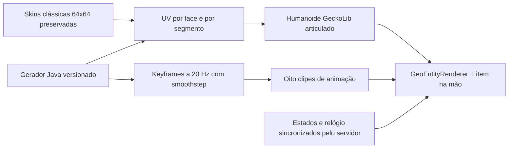

### Saída do chão

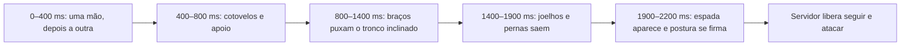

A fase é calculada pelo relógio do mundo, com atraso de **0, 2, 4, 6 e 8 ticks** entre as cinco unidades. A animação usa rotação de membros e translação não uniforme do root. A posição física continua acima do solo, com colisão normal, sem destruir blocos e sem ataques antes do término. O salvamento preserva a fase e o atraso restantes.

### Alcance e impacto

O ataque mede a distância entre as **hitboxes reais**, permitindo uma folga máxima de 1,9 bloco entre suas superfícies. Para duas entidades com largura 0,6, equivale a aproximadamente **2,5 blocos entre os centros**; alvos maiores são tratados por suas dimensões. Não há aumento de hitbox. Tanto a preparação quanto o impacto exigem alcance e linha de visão.

O servidor aplica dano uma vez no **tick 5 / 250 ms**. Os clipes têm uma pose de impacto nesse instante, e o controller consulta o início de ataque sincronizado para buscar o frame correto, inclusive quando um cliente começa a observar a entidade depois. Um impulso horizontal adicional de 0,2, sujeito à resistência a knockback vanilla, torna o acerto perceptível.

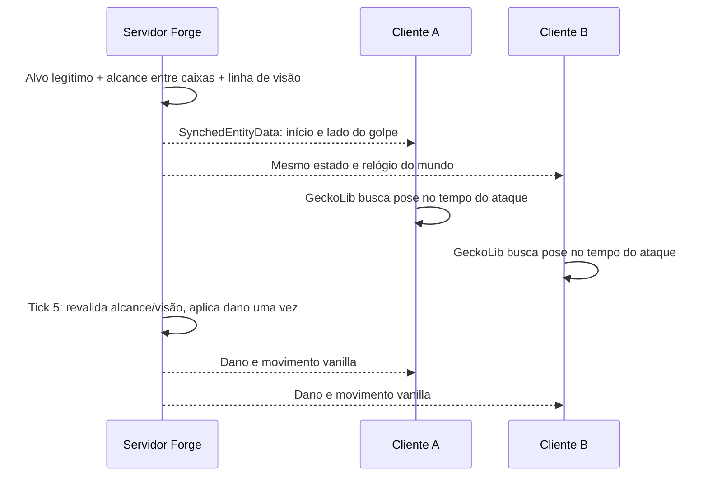

## Exército Ucraniano: novidades desta versão

| Recurso | Funcionamento |
| --- | --- |
| Invocação de Arthur | Só o Invocador, em combate legítimo; conjura por 20 ticks e cria até cinco unidades |
| Recarga | 700 ticks por Arthur; não espera 35 segundos pela primeira leva |
| Capacidade | 30 unidades por dono, configurável; uma leva parcial só ocupa as vagas restantes |
| Combatentes | Skin 64×64 original, 15 HP padrão e espada de ferro personalizada |
| Espada Ucraniana | Mesmo tier, modificadores, durabilidade e velocidade da espada de ferro; dano nominal total 6, sem bônus do Arthur |
| Emergência | 44 ticks articulados, mais atraso individual; hitbox sobre terreno válido e ataques bloqueados até terminar |
| IA | Seguir e defender o próprio Arthur, compartilhar alvos legítimos e revidar; sem ataques contra o dono, suas irmãs ou Renan |
| Animações | Oito clipes GeckoLib 4; braços, cotovelos, coxas e joelhos independentes; impacto no tick 5 |
| Áudio | Novo efeito de 5,90 s em `audios/ucraniana/efeito sonoro spawn ucrania.MP3`, inteiro e uma vez por cast |
| Ciclo de vida | UUID de dono persistido, contagem inclui tropas descarregadas, morte do dono dissipa unidades; duração padrão de 5 minutos carregados |
| Painel | Quatro opções: Renan, Combatente, Invocador e Ucraniana; prévias e informações por variante |

GeckoLib 4.8.4 é a biblioteca oficial obrigatória. Ars Nouveau e Iron's Spells continuam sem dependência no projeto. [APIs, decisões e fontes oficiais](docs/GECKOLIB_0.004.md).

### Configurar a habilidade

Forge gera o arquivo `serverconfig/guerra_ezuberante-server.toml` na pasta do mundo:

```toml
[arthur]
arthur_summon_enabled = true
arthur_summon_count = 5
arthur_summon_cooldown_ticks = 700
arthur_max_active_summons = 30
ukrainian_fighter_max_health = 15.0
ukrainian_fighter_emergence_ticks = 44
ukrainian_fighter_lifetime_ticks = 6000
ukrainian_fighter_orphan_grace_ticks = 200
```

Os tempos em segundos pressupõem 20 TPS. A vida configurada é aplicada a novas invocações. A contagem por dono é salva em SavedData, incluindo unidades descarregadas; mudanças de configuração não removem à força tropas já existentes. [Detalhes de segurança e persistência](docs/INVOCACAO_0.003.md).

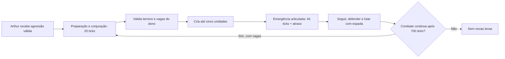

Para testar: invoque Arthur e Renan pelos ovos, confirme a paz inicial e ataque Arthur em Survival/Adventure. Observe o cast, as unidades, as espadas e a emergência. Para dar a espada ao jogador, use `/give @p guerra_ezuberante:espada_ucraniana`. As combatentes entram pela habilidade; não existe ovo avulso delas nesta versão.

### Prévia capturada no Minecraft


<details>
<summary>Ver combate e painel</summary>


</details>

As imagens são capturas do cliente de validação em mundo isolado. O relatório distingue os testes de servidor, a inspeção visual e o multiplayer com dois jogadores que ainda não foi executado.

## Base de personagens e desenvolvimento

### O que foi implementado

| Recurso | Implementação |
| --- | --- |
| Renan Santos | Entidade `guerra_ezuberante:renan_santos`, skin original, 30 HP e dano 4 |
| Arthur do Val | Entidade `guerra_ezuberante:arthur_do_val`, skin 64×64 do autor, 32 HP e dano 5; escala 0,88 |
| Comportamento | Caminhada e observação; perseguição e socos somente após agressão válida, sem iniciar brigas espontaneamente |
| Atributos | Renan: velocidade 0,25 e hitbox 0,6 × 1,8. Arthur: 0,24 e hitbox 0,528 × 1,584. Ambos recebem dano, morrem e perseguem até 20 blocos |
| Persistência | Sem desaparecimento por distância; dados e recarga de voz salvos com a entidade |
| Spawn eggs | Renan preto/amarelo e Arthur azul-claro/jeans, juntos na aba Guerra Ezuberante |
| Falas | Duas falas do Renan e sete gravações únicas do Arthur, completas e escolhidas aleatoriamente pelo botão direito |
| Cooldown | Renan: falas 15/4 s e phonk 14 s. Arthur: falas de 9 a 18 s. Recargas individuais e persistentes; sem reinício a cada golpe |
| Rede | Som disparado pelo servidor; reação de combate vinculada à entidade e acompanhando sua posição pelo protocolo nativo |
| Painel | Tecla K configurável: Início, Personagens, Facções, Habilidades e Sobre |
| Apresentação | Design preto/cinza/amarelo preservado; seleção de Renan, Arthur ou Ucraniana com atributos e prévia 3D, dentro de um mundo |
| Traduções | Português do Brasil e inglês; nomes, mensagens, legendas e páginas traduzíveis |

A escolha de facção e os poderes ainda planejados são **informativos**; a invocação de Arthur já é funcional e automática em combate. Ouvir “Me Respeita” não executa o ataque giratório. O arquivo “Me respeita, creu creu - PHONK” foi fornecido nesta sprint e integrado separadamente. Nenhum áudio foi inventado, acelerado ou cortado.

### Ambiente e IntelliJ

1. Abra a pasta do repositório como projeto Gradle no IntelliJ IDEA.
2. Configure **Project SDK e Gradle JVM como JDK 17**. Java 8 não serve para esta base.
3. Aguarde a importação das dependências oficiais. O Wrapper é **Gradle 8.8** e o ForgeGradle está fixado em **6.0.54**.
4. Execute `genIntellijRuns` para gerar as configurações de execução da IDE, se necessário.

Há um JDK 17 portátil em `.tools/jdk17/` neste workspace para os testes locais. Ele não é versionado. Em outro computador, instale um JDK 17 e configure `JAVA_HOME`.

O auxiliar PowerShell escolhe o JDK portátil, quando presente, e mantém o cache em `.gradle-user/`. Na raiz do projeto:

```powershell
# Compilar e gerar o JAR
powershell -NoProfile -ExecutionPolicy Bypass -File tools/gradle.ps1 build

# Abrir o Minecraft de desenvolvimento
powershell -NoProfile -ExecutionPolicy Bypass -File tools/gradle.ps1 runClient

# Iniciar o servidor dedicado de desenvolvimento
powershell -NoProfile -ExecutionPolicy Bypass -File tools/gradle.ps1 runServer

# Gerar configurações para o IntelliJ
powershell -NoProfile -ExecutionPolicy Bypass -File tools/gradle.ps1 genIntellijRuns

# Testes de integração no servidor Forge, sem interface gráfica
powershell -NoProfile -ExecutionPolicy Bypass -File tools/gradle.ps1 runGameTestServer
```

Com `JAVA_HOME` apontando para um JDK 17, o Wrapper também funciona diretamente: `./gradlew.bat build`, `./gradlew.bat runClient` e `./gradlew.bat runServer`. O servidor de desenvolvimento usa `run-server/`; leia e aceite pessoalmente a EULA, quando solicitada pelo Minecraft, antes de usá-lo.

### Teste dentro do jogo

1. Crie um mundo de teste em modo criativo.
2. Abra a aba **Guerra Ezuberante** e pegue os ovos do Renan e do Arthur.
3. Invoque ambos, observe as skins e compare a altura. Eles devem conviver sem agressão espontânea.
4. Botão direito reproduz falas. Para testar combate, mude para Survival ou Adventure e ataque um personagem: ele revida. Renan inicia o phonk; Arthur toca sua reação e conjura as combatentes quando há vagas; os eventos de áudio anteriores permanecem.
5. Pressione **K** e navegue pelas cinco páginas. A tecla pode ser alterada em Opções → Controles.
6. Salve e reabra o mundo para conferir a persistência. Para as legendas das falas, ative as legendas nas opções de acessibilidade do Minecraft.

Com comandos habilitados:

```mcfunction
/give @p guerra_ezuberante:renan_spawn_egg
/summon guerra_ezuberante:renan_santos ~ ~ ~
/give @p guerra_ezuberante:arthur_do_val_spawn_egg
/summon guerra_ezuberante:arthur_do_val ~2 ~ ~
/give @p guerra_ezuberante:arthur_do_val_combatente_spawn_egg
/give @p guerra_ezuberante:arthur_do_val_invocador_spawn_egg
/summon guerra_ezuberante:arthur_do_val_combatente ~2 ~ ~
/summon guerra_ezuberante:arthur_do_val_invocador ~4 ~ ~
```

O JAR atual fica em **`build/libs/guerra_ezuberante-0.014.3.jar`**. O build prepara **`build/distributions/guerra-ezuberante-0.014.3/mods/`** com o mod, GeckoLib 4.8.4 e TaCZ 1.1.8-hotfix2 originais, separados, e **`build/distributions/guerra-ezuberante-0.014.3-sem-tacz/mods/`** apenas com o mod e GeckoLib. A GE-P12 funciona nos dois conjuntos. Não distribua `.tools/` ou caches, nem instale múltiplas versões do mod juntas.

### Áudios: entrada, conversão e novas falas

Os MP3s estão organizados em `assets-entrada/audio/renan/` e `assets-entrada/audio/arthur/`. As cópias soltas da primeira versão foram preservadas. Os arquivos da pasta original `audios/` foram preservados. MP3s originais e ferramentas portáteis são ignorados pelo Git; os OGGs de recursos fazem parte do mod.

```powershell
powershell -NoProfile -ExecutionPolicy Bypass -File tools/convert_audio.ps1 -Character renan
powershell -NoProfile -ExecutionPolicy Bypass -File tools/convert_audio.ps1 -Character arthur
```

O script procura FFmpeg no PATH ou em `.tools/ffmpeg/`. Aceita `-Character`, `-FFmpegPath` e `-InputDirectory`, e evita cópias de áudios com hash idêntico. Converte os arquivos completos para **Ogg Vorbis, mono, 44.100 Hz, qualidade 4**, normaliza nomes, rejeita colisões e mantém os originais.

| Arquivo empacotado | Duração medida | Evento |
| --- | --- | --- |
| `sounds/renan/me_respeita.ogg` | Aproximadamente 13,48 s | `guerra_ezuberante:renan.me_respeita` |
| `sounds/renan/risadinha.ogg` | Aproximadamente 2,38 s | `guerra_ezuberante:renan.risadinha` |
| `sounds/renan/phonk.ogg` | Aproximadamente 12,59 s | `guerra_ezuberante:renan.phonk` |

Os nove MP3s do Arthur correspondem a sete gravações únicas, entre 7,89 e 16,69 s. Todos foram preservados, e os sete OGGs únicos foram registrados. Consulte [o inventário completo](docs/AUDIOS.md) para nomes, duplicatas e recargas. O autor escolheu a gravação inteira “É vagabundo sim” para a reação de combate, com recarga de 11 s.

O autor fornece novos MP3s. O agente converte as gravações e atualiza `ModSounds.java`, `sounds.json`, legendas e listas de fala, com recarga compatível. Converter um MP3 sozinho não o registra no jogo; essa integração é feita pelo agente.

Se um OGG estiver ausente, a interação ignora aquela fala. Se nenhuma estiver instalada, o jogo informa a falta dos arquivos em vez de tentar reproduzi-los.

### Trocar a skin

O autor fornece uma skin **PNG 64×64, modelo clássico/Steve**. O agente integra o arquivo nos dois caminhos:

- `assets-entrada/skins/renan_santos_skin_64x64.png` — fonte de trabalho.
- `src/main/resources/assets/guerra_ezuberante/textures/entity/renan_santos.png` — textura carregada pelo jogo.

Para Arthur, use `assets-entrada/skins/arthur_do_val_skin_64x64_corrigida.png` e `src/main/resources/assets/guerra_ezuberante/textures/entity/arthur_do_val.png`. O PNG continua 64×64: escala 0,88, hitbox e altura dos olhos pertencem à entidade e ao renderer.

O agente integra as texturas e recompila o JAR. O renderer GeckoLib usa UVs clássicas 64×64, com braços e pernas subdivididos por script. Uma troca de skin no mesmo padrão dispensa modelagem ou keyframes manuais.

### Verificações de recursos

```powershell
powershell -NoProfile -ExecutionPolicy Bypass -File tools/validate_assets.ps1
```

O validador verifica JSONs, paridade das traduções, legendas, referências de OGG, tamanho da skin e igualdade entre a textura fonte e a empacotada. `validate_gecko.ps1` também verifica ossos, UVs subdivididas, timestamps, clipes e dependência. Ambos fazem parte do build. `generate_gecko.ps1` regenera os modelos e as animações sem edição manual. Os resultados reais estão em [docs/VALIDACAO.md](docs/VALIDACAO.md).

O idioma do painel acompanha o idioma escolhido no Minecraft. Para usar os textos em português, selecione **Português (Brasil)** nas opções de idioma do jogo. Os testes em `src/gameTest/` são executados separadamente e não entram no JAR distribuído.

## Navegação

- [Visão do jogo, facções e personagens](#visao)
- [Tecnologias: o que usaremos e por quê](#tecnologias)
- [Facção, classe e personagem](#conceitos)
- [Experiência do jogador](#experiencia)
- [Arquitetura do mod](#arquitetura)
- [Combate, habilidades e invocações](#combate)
- [Arte, modelos, animações e áudio](#arte)
- [Como vamos construir e testar](#desenvolvimento)
- [Roadmap e critérios de aceite](#roadmap)
- [Organização dos arquivos](#arquivos)
- [Decisões pendentes](#pendencias)
- [Documentos e referências](#referencias)

<a id="visao"></a>

## Conceito e direção

Transformar o Minecraft em um campo de batalha político caótico, multiplayer e completamente satírico. Personagens inspirados em figuras públicas terão poderes absurdos, exércitos próprios, invocações, alianças, músicas, transformações e habilidades especiais.

Os ataques, falas e relações descritos são caricaturas fictícias de videogame. As diferenças de poderes entre facções são escolhas de gameplay e balanceamento.

A estratégia de desenvolvimento é construir primeiro uma base que funcione, depois os personagens e, por fim, as batalhas gigantes. Cada marco deve funcionar antes da expansão seguinte.

Indicadores da visão original: seis facções iniciais, mais de onze personagens nomeados e primeiro marco de implementação chamado v0.001.

## Facção, classe e personagem

Três conceitos devem permanecer separados:

| Conceito | Significado | Exemplo |
| --- | --- | --- |
| Facção | Equipe, identidade e relações de aliados/inimigos | Direita Missão |
| Classe de combate | Arquétipo e função do jogador na batalha | Invocador |
| Personagem | Entidade independente com IA e conjunto de habilidades | Renan Santos |

Um jogador pode escolher Direita Missão, jogar de Invocador e utilizar poderes ligados ao Renan. Paralelamente, Renan pode existir como mob independente, invocado por spawn egg. Isso evita misturar a IA dos personagens com o controle das habilidades dos jogadores.

## As seis facções

| Facção | Identidade de gameplay | Conteúdo associado |
| --- | --- | --- |
| Esquerda Lulista | Invocações, comida e mortos-vivos | Lula, Janones, Boulos, artistas mainstream, burros zumbificados, feijão e meteoritos de picanha |
| Direita Bolsonarista | Aliados internacionais, bombas e ataques de dinheiro | Jair, Flávio e Eduardo Bolsonaro, Nikolas Ferreira, Donald Trump e Benjamin Netanyahu |
| Direita Missão | Invocação, transformação e cavalaria | Renan Santos, Arthur do Val, Glenda, nerds montados em onças e loiras ucranianas |
| Esquerda Independente | Defesa, suporte e poderes genéricos | Resistência em grupo, recuperação gradual de vida e controle de multidões |
| Direita Independente | Combate direto, precisão e poderes genéricos | Dano individual, velocidade e precisão |
| Centro | Versatilidade, negociação e poderes genéricos | Alternância adaptativa entre defesa, mobilidade e suporte |

As três primeiras são facções especiais, com líderes, habilidades próprias e tropas exclusivas. As três restantes são escolhas independentes com conjuntos básicos de habilidades.

### Seleção e persistência

- **Implementado na 0.012.0:** no primeiro ingresso no mundo, o jogador vê a interface de escolha de facção.
- **Implementado na 0.012.0:** a escolha fica salva no mundo e continua válida após desconectar e voltar ao servidor.
- **Implementado na 0.012.0:** o administrador troca ou remove a facção com `/ge faccao definir` e `/ge faccao limpar`.
- **Implementado na 0.012.0:** prefixo colorido da facção no nome, um poder ativo (tecla B), um passivo e um kit inicial por facção.
- **Proposta do colaborador na 0.012.0, aceita pelo autor na integração 0.012.1:** jogadores da mesma facção **não** ficam protegidos entre si; fogo amigo continua ativo, respeitando PvP e equipes do servidor.

As regras completas de diplomacia, fogo amigo, troca de facção e progressão ainda precisam de detalhamento.

### Mapa de relações

O diagrama representa vínculos e conteúdo associado. Nem toda ligação representa uma invocação direta; as habilidades do catálogo esclarecem essas relações.

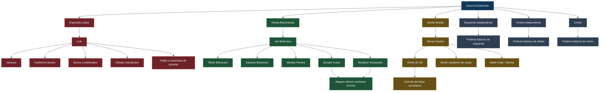

## Catálogo de personagens e habilidades

Os poderes de combate deste catálogo estão planejados e ainda não têm valores de balanceamento. O protótipo do Renan já possui vida, movimento e recarga das falas definidos na seção inicial; isso não implementa os ataques especiais abaixo.

### Renan Santos

Facção: Direita Missão. Papel: boss, invocador e DPS (dano).

| Habilidade | Comportamento previsto |
| --- | --- |
| Me Respeita | Gira disparando projéteis em todas as direções, acompanhado de funk |
| Arthur do Val | Invoca Arthur; este poderá convocar seu próprio exército |
| Modo Chad | Ao negar a Glenda, recebe aumento de dano, velocidade e resistência, com aura visual |
| Cavalaria da Missão | Invoca nerds com lanças medievais montados em onças |
| Ultimate — Moggador Supremo | Combina rotação, disparos e cavalaria em uma sequência especial |

Renan é o personagem piloto confirmado. O protótipo utiliza a skin clássica 64×64 fornecida pelo autor; os poderes deste catálogo continuam planejados.

### Arthur do Val

Facção: Direita Missão. Papel: invocador e suporte ofensivo.

| Habilidade | Comportamento previsto |
| --- | --- |
| Exército Ucraniano | Invoca unidades de loiras ucranianas que atacam inimigos |
| São Fáceis Porque São Pobres | Nome de habilidade satírica no conceito; fala e bônus temporário de ataque para suas unidades |
| Reforços | Repõe parcialmente as tropas perdidas |
| Ultimate — Legião Ucraniana | Invoca uma formação maior de combatentes |

As unidades do exército terão modelo, comportamento e atributos próprios.

### Lula

Facção: Esquerda Lulista. Papel: boss, necromante e dano em área.

| Habilidade | Comportamento previsto |
| --- | --- |
| Dedos de Feijão | Dispara rajadas de feijões nos inimigos |
| Picanha Meteorítica | Faz chover meteoritos de picanha |
| Exército dos Mortos | Invoca burros zumbificados que perseguem inimigos |
| Convocação Política | Invoca Janones, Boulos e tropas caricatas de artistas mainstream |
| Ultimate — Chuva de Picanha | Bombardeio de área com diversos meteoritos |

### Jair Bolsonaro

Facção: Direita Bolsonarista. Papel: boss, comandante e controle.

| Habilidade | Comportamento previsto |
| --- | --- |
| Clã Bolsonaro | Invoca Flávio e Eduardo Bolsonaro |
| Reforço Conservador | Invoca Nikolas Ferreira |
| Aliança Internacional | Invoca Trump e Netanyahu |
| Funk Temporal | Coreografia com distorção visual do tempo e redução da velocidade dos inimigos |
| Ultimate — Caos Internacional | Combina dança, reforços e ataques explosivos dos aliados |

### Flávio Bolsonaro

Facção: Direita Bolsonarista. Papel: DPS e ataque à distância.

| Habilidade | Comportamento previsto |
| --- | --- |
| Rachadinha | Projéteis de dinheiro se dividem em duas partes durante o voo |
| Lula é Pobre | Provoca inimigos próximos e aumenta temporariamente o próprio dano |
| Chuva de Notas | Dispara múltiplos projéteis de dinheiro |

### Demais personagens, tropas e eventos

| Personagem ou unidade | Vínculo / papel | Mecânica prevista |
| --- | --- | --- |
| Janones | Suporte lulista | Provocação e fortalecimento de aliados |
| Guilherme Boulos | Tanque lulista | Defesa e combate corpo a corpo |
| Eduardo Bolsonaro | Reforço bolsonarista | Ataques e bônus de equipe |
| Nikolas Ferreira | Suporte bolsonarista | Buffs e provocações |
| Donald Trump | Boss invocável, aliado bolsonarista | Bombardeios aéreos fictícios |
| Benjamin Netanyahu | Boss invocável, aliado bolsonarista | Bombardeios fictícios em área |
| Nerds montados em onças | Cavalaria da Missão | Investida com lanças |
| Loiras ucranianas | Exército de Arthur | Formação e combate em grupo |
| Burros zumbificados | Exército de Lula | Ataques em massa |
| Artistas mainstream | Tropas lulistas | Suporte e efeitos sonoros |
| Glenda | NPC de evento ligado ao Renan | Evento que ativa a transformação Chad |

## Classes jogáveis

| Classe | Função | Características |
| --- | --- | --- |
| Combatente | Dano direto | Ataques rápidos e combos |
| Tanque | Resistência | Vida alta, escudos e provocação |
| Invocador | Controle de tropas | Criação de aliados temporários |
| Especialista | Poderes especiais | Projéteis, efeitos e manipulação de área |
| Suporte | Fortalecimento | Cura, buffs e proteção |

Qualquer facção poderá utilizar os arquétipos; as habilidades disponíveis dependerão da combinação entre facção e classe. Um Invocador da Missão terá tropas diferentes das de um Invocador Lulista. Um Combatente da Direita Independente usará poderes genéricos, sem receber automaticamente os especiais de Bolsonaro.

Ainda não há uma matriz completa de habilidades para cada combinação.

## Modos de jogo e expansão

### Laboratório político — criativo

Modo prioritário para desenvolver e testar. Os spawn eggs ficarão disponíveis em uma aba exclusiva chamada **Guerra Ezuberante**, permitindo invocar personagens, montar batalhas e testar habilidades. A disponibilidade será ampliada conforme cada entidade for implementada.

### Guerra de facções — multiplayer

Jogadores escolhem uma facção, recebem poderes e enfrentam outras equipes. O modo prevê regras de aliados e inimigos, progressão e habilidades especiais.

### Ideias futuras

Batalhas de chefes, arenas eleitorais, guerras entre facções e campanhas com missões. Essas ideias ainda não têm especificação detalhada nem marco reservado.

<a id="tecnologias"></a>

## Tecnologias: o que usaremos e por quê

A base implementada é Minecraft 1.20.1, Forge 47.4.28, Java 17, ForgeGradle 6.0.54 e Gradle Wrapper 8.8. As ferramentas de arte e os sistemas de dados avançados continuam opcionais ou planejados conforme a tabela.

### Base do mod

| Tecnologia | Para que serve | Por que usar neste projeto | Situação |
| --- | --- | --- | --- |
|  | Plataforma em que existirão as entidades, os itens e as batalhas | Integrar os personagens ao mundo, ao inventário criativo e ao multiplayer | Minecraft 1.20.1 |
|  | Programar entidades, IA, poderes e regras | Organizar comportamentos compartilhados e a lógica do mod na plataforma escolhida | Java 17 |
|  | API e infraestrutura para integrar o mod ao Minecraft | Base proposta para registros, entidades, itens e eventos | Forge 47.4.28 |
|  | Organizar compilação, dependências e empacotamento | Reproduzir o build e gerar o JAR a partir do projeto versionado | Gradle 8.8 + ForgeGradle 6.0.54 |

Forge substitui a sugestão inicial de loader e é a API escolhida para esta implementação 1.20.1. A documentação oficial dessa versão orienta os registros, a entidade e o áudio. [Documentação oficial do Forge](https://docs.minecraftforge.net/en/1.20.1/).

O Gradle Wrapper oficial do MDK está versionado e utiliza Gradle 8.8. O ForgeGradle foi fixado em 6.0.54 para tornar a configuração explícita. [Conceitos do Gradle](https://docs.gradle.org/current/userguide/gradle_basics.html), [Gradle Wrapper](https://docs.gradle.org/current/userguide/gradle_wrapper.html).

### Conteúdo, arte e animação

| Tecnologia | Para que serve | Por que usar neste projeto | Situação |
| --- | --- | --- | --- |
|  | Gerar modelos, UVs e animações | Pipeline determinístico mantido pelo agente, com validação; dispensa Blockbench e ajustes manuais do autor | Implementado |
|  | Biblioteca oficial de animações | Modelos articulados, oito clipes e renderização por ossos; dependência obrigatória no cliente e servidor | Implementado |
|  | Descrever dados e recursos nos formatos definidos | Ajustar parâmetros suportados sem espalhar valores fixos por várias classes | Esquema futuro |

GeckoLib 4.8.4 já executa os modelos e as animações articuladas. O gerador Java substitui a modelagem e a criação manual de keyframes no Blockbench; o autor não precisa usar esse editor. [Documentação oficial GeckoLib 4](https://github.com/bernie-g/geckolib/wiki/Installation-(Geckolib4)).

Os dados personalizados em JSON precisarão de leitores e validação implementados pelo mod. JSON poderá configurar os comportamentos suportados; comportamentos novos continuarão exigindo programação. Os recursos do Minecraft seguirão os formatos da versão alvo.

### Versionamento e documentação

| Tecnologia | Para que serve | Por que usar neste projeto | Situação |
| --- | --- | --- | --- |
|  | Registrar alterações e histórico | Comparar mudanças e recuperar uma base funcional | Em uso |
|  | Hospedar projeto e documentação | Centralizar o trabalho e acompanhar a evolução | Em uso |
|  | Escrever README, design e contexto | Manter o planejamento legível e versionado com o código | Em uso |
|  | Descrever fluxos e arquitetura em texto | Atualizar os diagramas junto das decisões do projeto | Em uso |

Os diagramas usam blocos Mermaid, formato renderizado pelo GitHub em arquivos Markdown. [Diagramas no GitHub](https://docs.github.com/en/get-started/writing-on-github/working-with-advanced-formatting/creating-diagrams).

O ambiente principal solicitado é IntelliJ IDEA no Windows. O Wrapper também permite executar o build pelo terminal. Um quadro de tarefas poderá ser criado depois para acompanhar as entregas.

### Como as ferramentas se encaixam

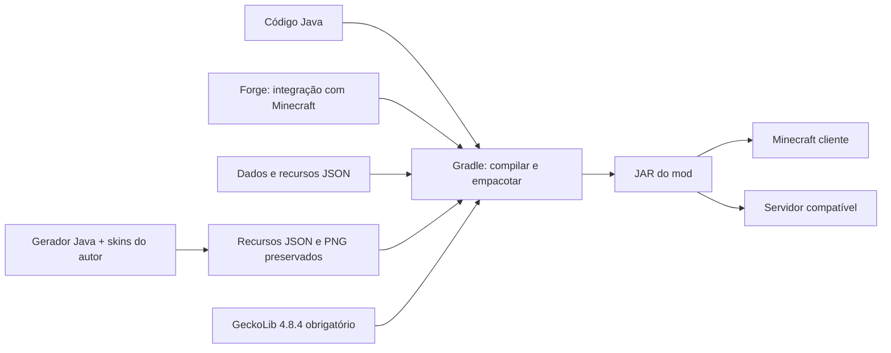

Esse é o caminho pretendido de compilação e distribuição. Os formatos de exportação e as dependências serão escolhidos antes de conectar arte e código.

<a id="conceitos"></a>

## Como facção, classe e personagem se conectam

A facção define o grupo e o repertório temático. A classe define a função de combate. O personagem é uma entidade independente com IA. A separação permite que jogadores e mobs utilizem habilidades compartilhadas, com formas diferentes de controle.

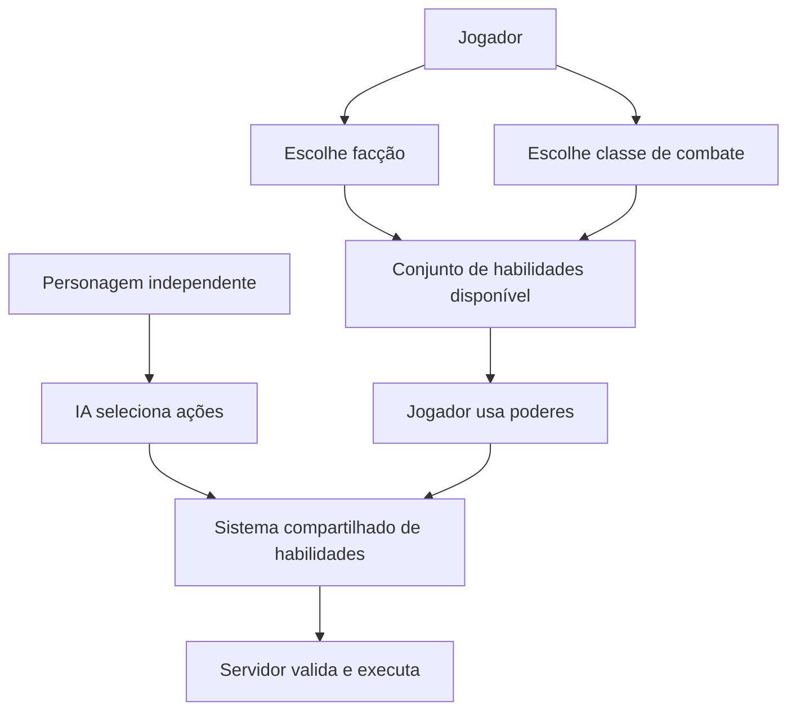

**Exemplo planejado:** um jogador da Missão e da classe Invocador poderá utilizar tropas ligadas à facção. Renan, quando invocado no mundo, será outro agente de combate com decisões próprias. A presença de Renan não transforma automaticamente o jogador nele.

Os papéis de boss, invocador e suporte do catálogo descrevem os personagens. A interface e as regras de seleção de classe dos jogadores ainda precisam ser detalhadas.

<a id="experiencia"></a>

## Experiência do jogador

### Entrada na guerra de facções

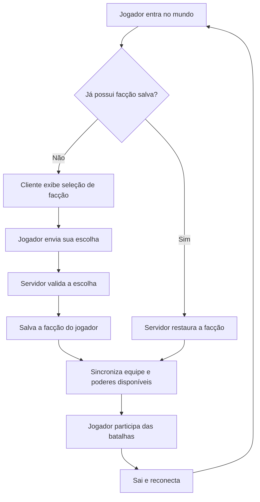

Esse é o fluxo pretendido do modo de facções. Escolhas inválidas, fechamento da seleção e permissões de troca precisarão de regras na implementação.

### Dois caminhos de uso

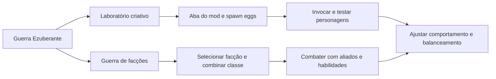

O laboratório será a primeira experiência funcional. A guerra multiplayer completa depende das entidades, dos poderes, das relações entre equipes e da persistência desenvolvidos nos marcos anteriores.

<a id="arquitetura"></a>

## Arquitetura do mod

Vamos separar registros de conteúdo, regras de jogo, habilidades, rede e apresentação. A estrutura deverá permitir acrescentar personagens sem reescrever o funcionamento de todos os outros.

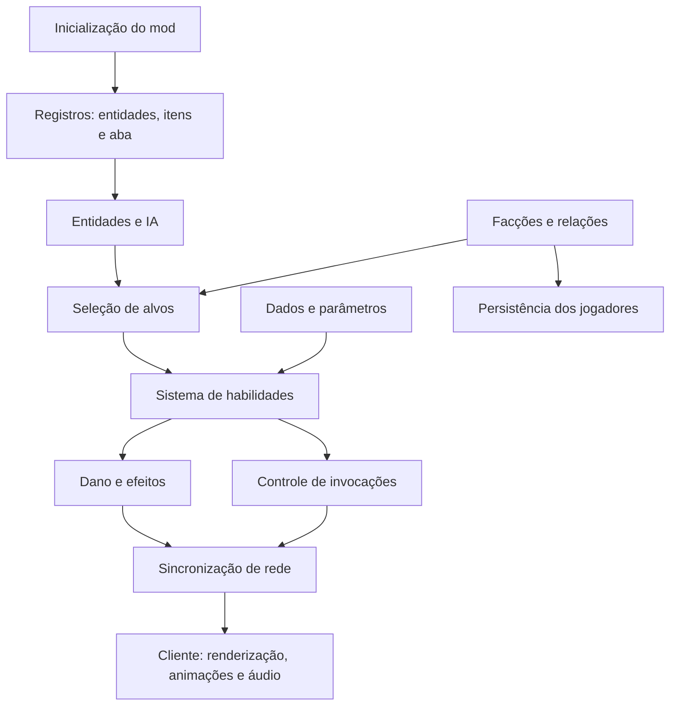

### Responsabilidade dos módulos

| Módulo proposto | Responsabilidade | Exemplo |
| --- | --- | --- |
| `registry` | Registrar conteúdo reconhecido pelo jogo | Renan, spawn egg e aba criativa |
| `entity` | Vida, movimento, IA e comportamento | Perseguir e atacar um alvo |
| `faction` | Identidade, equipes e dados de facção | Identificar aliados e inimigos |
| `ability` | Contrato e execução de poderes reutilizáveis | Me Respeita com condições e recarga |
| `combat` | Alvos, dano e gerenciamento de tropas | Aplicar dano e limitar invocações |
| `client` | Renderizadores, modelos, animações e interfaces | Exibir aura e seleção de facção |
| `network` | Comunicar intenções e estados necessários | Solicitar um poder e sincronizar seu resultado |
| Recursos e dados | Texturas, modelos, áudio, traduções e parâmetros | Aparência e dados dos personagens |

A primeira versão conterá apenas as partes necessárias ao piloto. A arquitetura será ampliada quando o comportamento exigir.

### Cliente e servidor

| Servidor: decide e mantém o estado | Cliente: apresenta e envia intenções |
| --- | --- |
| Valida facção, alvo, alcance, condições e recarga | Exibe interfaces e captura entradas do jogador |
| Calcula e aplica dano e efeitos | Renderiza personagens, projéteis e partículas |
| Cria, controla e remove tropas | Executa animações e áudio conforme os estados recebidos |
| Mantém dados persistentes | Apresenta facção e indicadores necessários |

Para personagens controlados pela IA, a decisão nasce no servidor. Para jogadores, o cliente envia uma intenção e o servidor valida antes de executar.

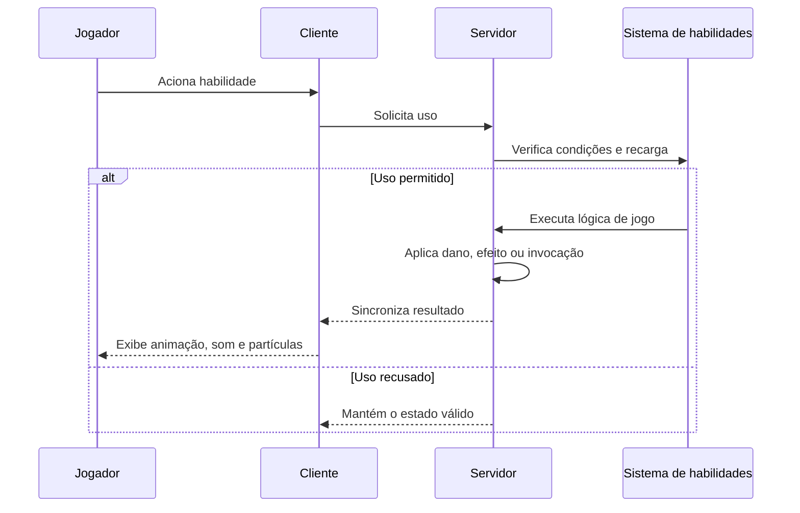

<a id="combate"></a>

## Combate, habilidades e invocações

### Habilidades e autoridade do servidor

Cada habilidade poderá configurar dano, alcance, recarga, duração e quantidade máxima de invocações.

O servidor será responsável por validar ataques, calcular dano e criar invocações. Os clientes apresentarão animações, sons, partículas e interfaces, com sincronização dos efeitos relevantes.

```mermaid
flowchart TD
    A["Personagem ataca"] --> B["IA seleciona habilidade"]
    B --> C{"Cooldown disponível?"}
    C -- Não --> D["Ataque básico"]
    C -- Sim --> E{"Alvo e condições válidos?"}
    E -- Não --> D
    E -- Sim --> F["Executa habilidade no servidor"]
    F --> G["Aplica dano, efeitos ou invocação"]
    G --> H["Sincroniza efeitos com clientes"]
    H --> I["Inicia cooldown"]
    I --> J["Volta ao combate"]
    D --> J
```

### Limites técnicos previstos

- Invocações com duração e quantidade máxima configuráveis.
- Ataques nucleares tratados como efeitos fictícios de videogame, sem destruição permanente de blocos por padrão.
- Distorção temporal aplicada a entidades e efeitos visuais, preservando o relógio global do servidor.
- IA evitando buscar todos os mobs desnecessariamente a cada tick.
- Gerenciador de áudio para músicas e falas.
- Sons originais ou com permissão para distribuição do mod, conforme previsto no material.

Limites concretos de entidades, intervalos de busca e metas de desempenho serão definidos com testes.

### Parâmetros de uma habilidade

| Parâmetro planejado | O que controla | Exemplo conceitual |
| --- | --- | --- |
| Identificador | Comportamento acionado | Giro do Renan |
| Dano | Impacto sobre o alvo | Dano de um projétil |
| Alcance / área | Onde o poder pode atingir | Distância de disparo ou raio de impacto |
| Cooldown | Intervalo mínimo entre usos | Tempo até o próximo giro |
| Duração | Tempo de um efeito | Duração do Modo Chad |
| Condições | Requisitos de uso | Ter inimigo válido no alcance |
| Limite de tropas | Quantidade máxima de invocações | Teto de unidades de Arthur |
| Apresentação | Efeitos e recursos associados | Animação, aura e som |

Isso orienta o design; ainda não há esquema JSON implementado. Os valores serão definidos com testes de combate.

### Ciclo de combate de uma entidade

```mermaid
stateDiagram-v2
    [*] --> Ocioso
    Ocioso --> Perseguindo: Detecta inimigo válido
    Perseguindo --> Atacando: Alvo entra no alcance
    Atacando --> Perseguindo: Alvo sai do alcance
    Atacando --> Ocioso: Alvo deixa de ser válido
    Perseguindo --> Ocioso: Perde o alvo
    Atacando --> Morto: Vida chega a zero
    Perseguindo --> Morto: Vida chega a zero
    Ocioso --> Morto: Vida chega a zero
    Morto --> [*]
```

Esse modelo simplifica o comportamento para orientar os testes. Durante o ataque, o sistema escolhe entre habilidade disponível e ataque básico.

### Ciclo de uma invocação

```mermaid
flowchart TD
    A["Personagem solicita reforços"] --> B["Servidor verifica condições e limites"]
    B --> C{"Pode invocar?"}
    C -- Não --> D["Não cria novas tropas"]
    C -- Sim --> E["Cria tropas com vínculo ao invocador e à facção"]
    E --> F["Tropas procuram inimigos válidos"]
    F --> G["Participam do combate"]
    G --> H{"Morreram ou atingiram a duração máxima?"}
    H -- Não --> F
    H -- Sim --> I["Remove a tropa e libera a contagem"]
```

O sistema deverá rastrear invocador, facção, duração e quantidade de tropas. O comportamento após morte ou desconexão do invocador ainda será definido. Invocações encadeadas, como Renan → Arthur → exército, também precisarão respeitar limites.

### Desempenho e limites

| Situação | Abordagem planejada | Como verificar depois |
| --- | --- | --- |
| Muitas tropas | Limitar duração e quantidade | Aumentar grupos gradualmente no servidor |
| Busca de inimigos | Buscar em área local e em intervalos adequados | Observar custo da IA em batalhas |
| Projéteis e partículas | Controlar tempo de vida e apresentação | Testar poderes isolados e combinados |
| Bombardeios | Separar dano de destruição de blocos | Conferir dano e preservação da arena |
| Dança temporal | Afetar entidades e efeitos visuais | Verificar estabilidade da simulação global |
| Músicas sobrepostas | Gerenciar início, fim e sobreposição | Ativar vários personagens simultaneamente |

Metas numéricas de desempenho e limites serão definidos quando houver um protótipo mensurável.

<a id="arte"></a>

## Arte, sprites, modelos e áudio

O autor forneceu a primeira skin do Renan e duas gravações de áudio. Os recursos visuais dos demais personagens serão desenvolvidos posteriormente.

Renan, Arthur e as combatentes usam skins PNG 64×64 no padrão clássico/Steve, aplicadas ao humanoide articulado GeckoLib gerado por código. Novos personagens podem reutilizar esse padrão; modelos diferentes também serão gerados pelo agente.

As imagens anexadas nesta etapa são diagramas de conceito e uma captura de indicadores, não sprites, texturas ou modelos prontos para o Minecraft.

A skin do Renan e os dois áudios convertidos estão em src/main/resources/assets/guerra_ezuberante/. A movimentação utiliza animação humanoide nativa; não há ataques ou coreografias especiais implementados.

### Caminho da arte até o jogo

```mermaid
flowchart LR
    A["Definir personagem e referência"] --> B["Escolher modelo compatível"]
    B --> C["Criar textura ou skin"]
    C --> D["Preparar animações"]
    D --> E["Exportar recursos"]
    E --> F["Conectar ao renderizador"]
    F --> G["Testar no Minecraft"]
    G --> H["Ajustar com o autor"]
    H --> B
```

O primeiro personagem utiliza a skin fornecida pelo autor. Recursos definitivos e novas animações poderão evoluir nos marcos seguintes. A ficha visual reunirá modelo, textura, animações, efeitos e sons; cada recurso será validado quando aparecer corretamente no jogo.

<a id="desenvolvimento"></a>

## Como vamos construir e testar

Cada etapa deverá produzir um resultado observável. Primeiro, um personagem aparece no mundo; depois ele enfrenta um alvo, usa um poder e participa de uma batalha contra outro personagem.

```mermaid
flowchart TD
    A["Definir versão do Minecraft"] --> B["Escolher ferramentas compatíveis"]
    B --> C["Criar base Java e Gradle"]
    C --> D["Registrar entidade, ovo e aba"]
    D --> E["Carregar aparência de teste"]
    E --> F["Validar cliente e servidor"]
    F --> G{"Critério do marco passou?"}
    G -- Não --> H["Corrigir e repetir o teste afetado"]
    H --> F
    G -- Sim --> I["Gerar JAR e registrar entrega"]
    I --> J["Avançar ao próximo marco"]
```

### Etapas práticas

1. **Definir a plataforma:** escolher Minecraft, Java, Forge e Gradle compatíveis.
2. **Criar a base mínima:** projeto compila e carrega no ambiente de desenvolvimento.
3. **Adicionar o piloto:** entidade, atributos, spawn egg e aba Guerra Ezuberante.
4. **Validar a apresentação:** renderizador e aparência provisória ou modelo preparado com o autor.
5. **Construir o combate:** detectar, perseguir, atacar, receber dano e morrer.
6. **Adicionar um poder completo:** condições, recarga, execução no servidor e efeitos no cliente.
7. **Adicionar um adversário:** primeira batalha automática entre facções diferentes.
8. **Expandir os sistemas:** seleção, persistência, tropas e personagens.
9. **Integrar e polir:** limites, balanceamento e alpha para os amigos.

### Plano de validação

| Área | Verificação planejada | Evidência esperada |
| --- | --- | --- |
| Build | Compilar e empacotar com o Wrapper | JAR gerado a partir do código versionado |
| Inicialização | Abrir cliente e iniciar servidor dedicado compatível | Sem falha de registro ou dependência de renderização no servidor |
| Invocação | Usar ovo e comando | Entidade aparece com atributos e aparência esperados |
| IA | Navegar até um alvo válido | Personagem se move e reage |
| Combate | Aplicar e receber dano, concluir morte | Resultado consistente no servidor |
| Poderes | Verificar alvo, alcance e cooldown | Sem dano duplicado ou repetição indevida |
| Multiplayer | Observar ações em clientes conectados | Estados e efeitos relevantes sincronizados |
| Persistência | Sair e reconectar após escolher facção | Escolha recuperada |
| Desempenho | Aumentar tropas e poderes | Limites funcionam e gargalos são identificáveis |

Essas verificações serão aplicadas conforme as funcionalidades existirem. Ainda não há resultados de testes de gameplay.

### Definição de uma entrega concluída

Cada marco deverá apresentar o comportamento previsto, passar pela validação adequada e ter a documentação atualizada. Compilar faz parte do processo; o funcionamento das entidades e dos poderes também precisará ser observado no jogo.

Os comandos executáveis de build, cliente e servidor estão no início deste README. Os critérios deste capítulo descrevem a estratégia também para versões posteriores.

<a id="roadmap"></a>

## Roadmap proposto

Os rótulos abaixo preservam o roadmap original. A versão técnica do primeiro protótipo é 0.002.0; os marcos futuros ainda não são releases. Não há prazos de calendário: a duração depende de IA, recursos visuais e testes.

| Sprint / versão | Escopo | Critério de aceite previsto |
| --- | --- | --- |
| 01 — v0.001 | Base Java/Forge/Gradle, entidade piloto Renan, modelo/textura, spawn egg, aba criativa, movimentação, comando e primeiro JAR | Abrir o Minecraft, pegar o ovo na aba do mod, invocar o personagem com aparência correta e vê-lo mover-se sem erros; validar cliente e servidor |
| 02 — v0.002 | IA e combate básico: detectar, perseguir, atacar, receber dano e morrer | Renan enfrenta um zumbi ou alvo de teste sem travar |
| 03 — v0.003 | Ataque giratório, projéteis, cooldown, efeitos simples e primeira animação de combate | Habilidade automática respeita a recarga e causa dano no servidor |
| 04 — v0.004 | Lula, spawn egg, feijões e identificação básica de facções inimigas | Renan e Lula se reconhecem como inimigos e lutam automaticamente |
| 05 — v0.005 | Tela de seleção, seis facções, poderes genéricos, persistência e alianças | Escolha do jogador permanece ao reconectar |
| 06 — v0.006 | Arthur, loiras ucranianas, cavalaria de onças e evento da Glenda | Renan convoca reforços que identificam e atacam inimigos corretamente |
| 07 — v0.007 | Janones, Boulos, burros zumbificados, artistas e meteoritos de picanha | Lula enfrenta um grupo de invocações da Missão |
| 08 — v0.008 | Bolsonaro, Flávio, Eduardo, Nikolas, dinheiro dividido e dança temporal | Reforços e efeitos bolsonaristas funcionam e são sincronizados |
| 09 — v0.009 | Trump, Netanyahu, bombardeios, explosões visuais e habilidades combinadas | Ataques de área funcionam preservando o desempenho do servidor |
| 10 — v0.010 | Integração de poderes, sons, interfaces, limites de invocação e balanceamento | Três facções lutam numa arena multiplayer sem erros críticos |
| 11 — v0.1.0 | Alpha: polimento, otimização, instalação, documentação e correções | Amigos conseguem reproduzir o mod no cliente e servidor com a mesma versão |

### Checklist implementado da v0.001

- [x] Criar o projeto Java 17 com Forge 47.4.28 e Gradle 8.8.
- [x] Registrar a entidade piloto Renan Santos.
- [x] Carregar modelo humanoide e skin fornecida pelo autor.
- [x] Criar o spawn egg exclusivo da entidade.
- [x] Criar a aba Guerra Ezuberante no inventário criativo.
- [x] Implementar movimentação e animação básica.
- [x] Permitir invocação por ovo e comando.
- [x] Executar build, GameTests de servidor e inicialização do cliente; ver limites em VALIDACAO.md.
- [x] Gerar o primeiro arquivo `.jar`.

O primeiro marco comprova a infraestrutura. Funk, exércitos, meteoritos e poderes especiais ficam nos marcos posteriores.

A skin inicial já foi fornecida e integrada. A validação visual do personagem e das telas deve ser registrada separadamente da compilação e dos testes de servidor.

### Dependência entre os marcos

```mermaid
flowchart TD
    A["v0.001: base e personagem piloto"] --> B["v0.002: IA e combate"]
    B --> C["v0.003: primeiro poder"]
    C --> D["v0.004: Lula e primeira batalha"]
    D --> E["v0.005: sistema de facções"]
    E --> F["v0.006: Arthur e Missão"]
    F --> G["v0.007: exército de Lula"]
    G --> H["v0.008: clã Bolsonaro"]
    H --> I["v0.009: caos internacional"]
    I --> J["v0.010: guerra completa"]
    J --> K["v0.1.0: alpha jogável"]
```

<a id="arquivos"></a>

## Organização dos arquivos

### Estrutura atual

```text
GUERRA/
├── README.md                     # Documentação principal no GitHub
├── CONTEXTO.md                   # Resumo para retomar o trabalho
├── build.gradle                  # ForgeGradle 6.0.54
├── settings.gradle
├── gradle.properties             # Minecraft, Forge e versão do mod
├── gradlew / gradlew.bat
├── gradle/wrapper/               # Gradle 8.8
├── assets-entrada/               # Skin fonte e MP3s locais
├── tools/                        # Build, conversão e validação
├── src/
│   ├── main/java/                # Mod, registros, entidade e código cliente
│   ├── main/resources/           # Metadados, skin, OGGs e traduções
│   └── gameTest/                 # Testes de servidor, fora do JAR final
└── docs/
    ├── IDEIA_GERAL.md            # Consolidação inicial do design
    ├── VALIDACAO.md              # Testes e limites observados
    ├── third-party/              # Licença e créditos do MDK
    └── referencias/
        ├── ideia-original.txt
        ├── faccoes-e-personagens.png
        ├── fluxo-de-habilidades.png
        └── visao-inicial.png
```

### Estrutura futura da implementação


A árvore abaixo é a estrutura-alvo de expansão. O pacote atual é `io.github.omarflk.guerraezuberante` e o mod ID é `guerra_ezuberante`. A entidade implementada chama-se `RenanSantosEntity`; facções, combate avançado e habilidades desta árvore são módulos futuros.

```text
src/main/java/io/github/omarflk/guerraezuberante/
├── GuerraEzuberanteMod.java
├── registry/
│   ├── ModEntities.java
│   ├── ModItems.java
│   └── ModCreativeTabs.java
├── entity/
│   ├── PoliticalMobEntity.java
│   ├── RenanEntity.java
│   ├── LulaEntity.java
│   ├── BolsonaroEntity.java
│   └── summons/
├── faction/
│   ├── Faction.java
│   ├── FactionManager.java
│   └── PlayerFactionData.java
├── ability/
│   ├── Ability.java
│   ├── AbilityManager.java
│   ├── AbilityContext.java
│   └── implementations/
├── combat/
│   ├── CombatManager.java
│   ├── TargetingService.java
│   └── SummonManager.java
├── client/
│   ├── renderer/
│   ├── model/
│   ├── animation/
│   └── gui/
└── network/
    └── packets/

src/main/resources/
├── assets/guerra_ezuberante/
│   ├── textures/
│   ├── models/
│   ├── animations/
│   ├── sounds/
│   └── lang/
└── data/guerra_ezuberante/
    └── characters/

gradle/
build.gradle
README.md
```

Uma entidade-base compartilhada poderá reunir comportamentos comuns. Subclasses específicas só serão necessárias para diferenças reais de comportamento. O sistema de habilidades deverá permitir ampliar personagens sem duplicar todo o código.

### Manutenção da documentação

| Arquivo | Papel |
| --- | --- |
| `README.md` | Documentação principal da ideia, tecnologias, funcionamento e construção do mod |
| `CONTEXTO.md` | Decisões, pendências e estado recente para retomar o trabalho |
| `docs/IDEIA_GERAL.md` | Consolidação inicial que serviu de base ao planejamento |
| `docs/referencias/` | Fontes originais e imagens recebidas |

O README deverá acompanhar as funcionalidades implementadas. Mudanças de design serão registradas para distinguir a proposta inicial das decisões novas.

<a id="pendencias"></a>

## Decisões pendentes e próximos passos

| Decisão | Estado atual | Quando resolver |
| --- | --- | --- |
| Nome público | **Guerra Ezuberante**, com z | Definido |
| Versão do Minecraft | 1.20.1 | Definido |
| Java, Forge e Gradle | Java 17, Forge 47.4.28 e Gradle 8.8 | Definido |
| Personagem piloto | Renan Santos | Implementado; veja a validação |
| Identificador técnico | `guerra_ezuberante` | Configurado |
| Pacote Java | `io.github.omarflk.guerraezuberante` | Configurado |
| Aparência inicial | Skin clássica 64×64 fornecida | Integrada |
| GeckoLib | 4.8.4 obrigatório | Integrado desde a sprint 0.004.0 |
| Atributos e recargas | Vida e recarga de voz definidas; poderes pendentes | Expandir na v0.002 |
| Fogo amigo e alianças | Aliados da mesma facção por padrão; detalhes pendentes | Ao implementar facções |
| Troca de facção | Permissão administrativa prevista; regras pendentes | Ao criar seleção e persistência |
| Progressão | Prevista, sem especificação | Antes de expandir a guerra |
| Limites de tropas | Configuráveis, sem números fixados | Ao implementar invocações |
| Distribuição e instalação | JAR local disponível; sem release publicada | Publicação futura |

A versão 0.004.0 migrou as animações para GeckoLib, articulou braços e pernas, separou os dois Arthurs e corrigiu alcance e emergência. O teste completo com dois clientes segue pendente após uma tentativa que parou no handshake Forge. O próximo ajuste visual depende do feedback do autor; sprites de outros personagens e novos poderes ficam para pedidos posteriores.

<a id="referencias"></a>

## Documentos e referências

- [Contexto resumido](CONTEXTO.md).
- [Documento inicial de ideia e design](docs/IDEIA_GERAL.md).
- [Texto original recebido](docs/referencias/ideia-original.txt).
- [Diagrama original de facções e personagens](docs/referencias/faccoes-e-personagens.png).
- [Diagrama original de habilidades](docs/referencias/fluxo-de-habilidades.png).
- [Captura dos indicadores iniciais](docs/referencias/visao-inicial.png).

As fontes históricas usam “Guerra Política”. O nome atual da interface, documentação e conteúdo público é **Guerra Ezuberante**. Propostas antigas nas fontes são referências históricas; as decisões técnicas atuais estão no início deste README e em CONTEXTO.md.

<details>
<summary>Ver os diagramas originais recebidos</summary>

### Facções e personagens


### Fluxo de habilidades


### Indicadores do conceito inicial


</details>

---

Planejamento documentado em **24/10/2026**. O roadmap descreve objetivos futuros e evoluirá conforme os primeiros testes no Minecraft.
