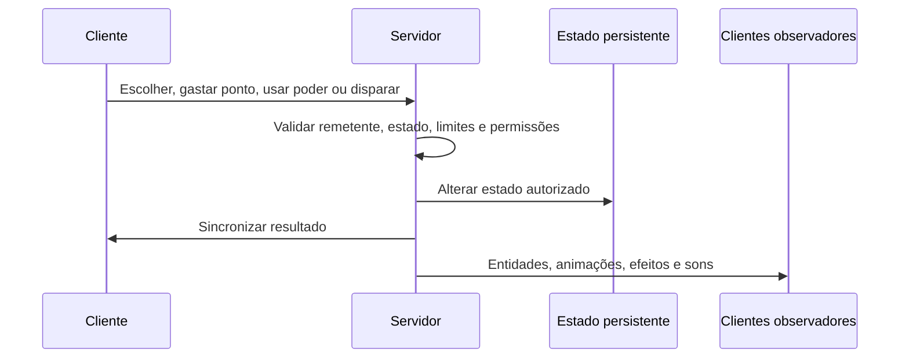
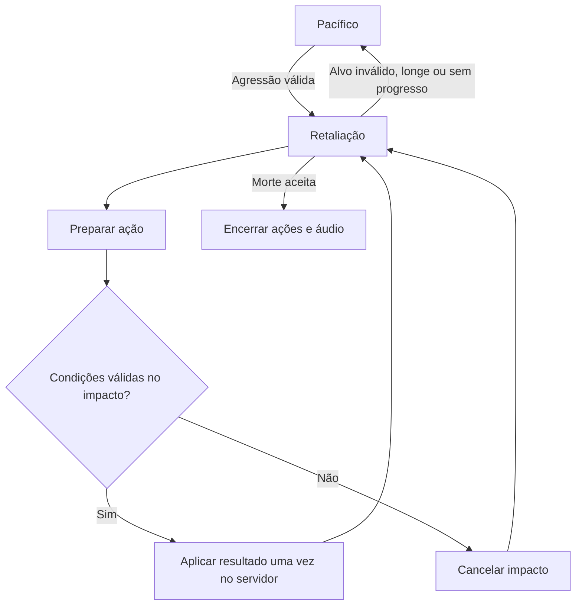
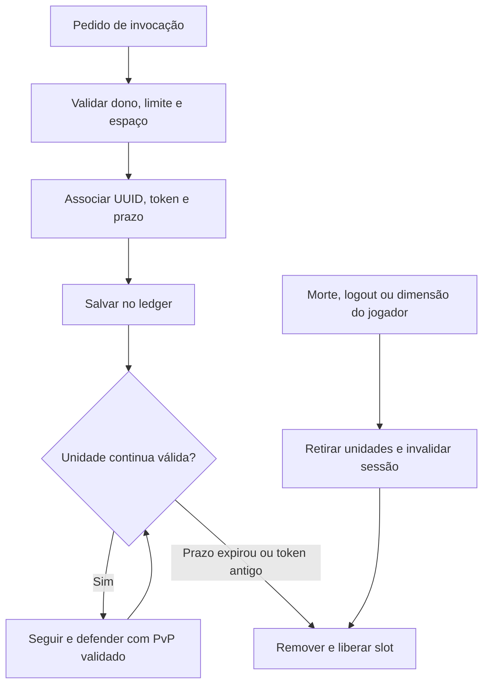
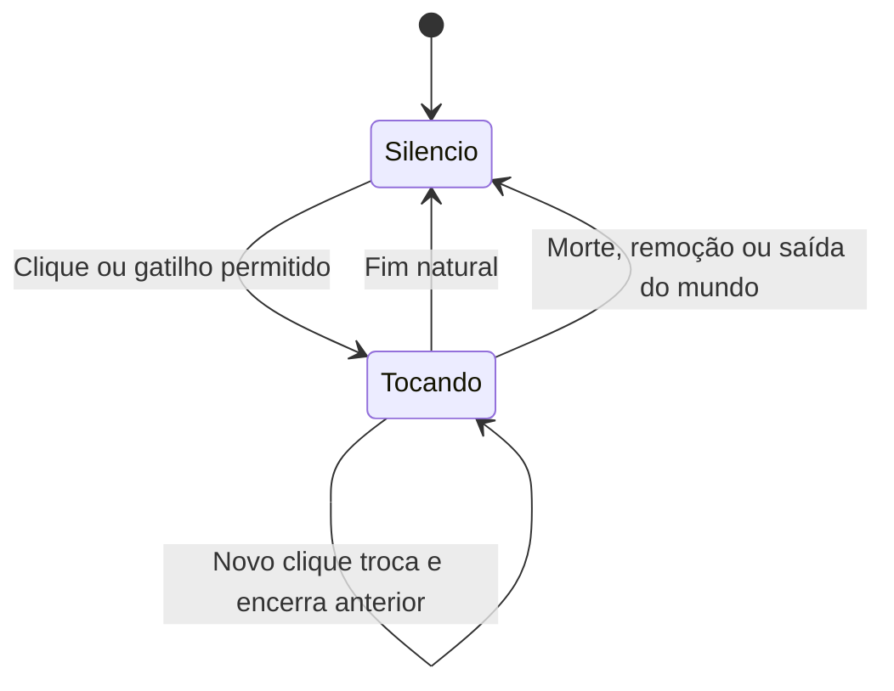

# Guerra Ezuberante — manual completo para IAs colaboradoras

**Referência:** versão 0.014.3, em 30/10/2026. **Projeto:** [OmarFLK/A-Guerra-Ezuberante](https://github.com/OmarFLK/A-Guerra-Ezuberante). **Nome:** Guerra **Ezuberante**, com **z**. **Namespace:** `guerra_ezuberante`. **Pacote Java:** `io.github.omarflk.guerraezuberante`.

Este arquivo reúne instruções de contribuição e uma fotografia das regras implementadas. Pode ser enviado inteiro como anexo a outra IA. Não depende de ela conhecer esta conversa, ter plugins específicos ou possuir os arquivos pessoais do autor. As referências relativas funcionam dentro do repositório; fora dele, procure os mesmos caminhos no clone.

## 1. Como usar este arquivo

O amigo que receber este documento pode enviar a seguinte mensagem à sua IA:

> Leia o SKILL.md anexado e trabalhe no repositório Guerra Ezuberante. Use-o como contexto técnico e regras do projeto. Confira a versão e o código do meu checkout antes de implementar. Minha tarefa nesta sessão é: **descrever aqui a mudança desejada**. Faça a implementação autorizada e os testes pertinentes; informe o resultado real, os arquivos alterados e as limitações. Não considere as ideias históricas como funcionalidades já implementadas. Não altere a main do projeto original sem autorização.

Para ferramentas que aceitam skills em pastas, o arquivo já tem o nome `SKILL.md` e frontmatter com `name` e `description`. Instale-o conforme o mecanismo da ferramenta utilizada; não há exigência de usar Codex, ChatGPT ou um plugin específico. Instalar a skill não fornece acesso ao GitHub nem permissões de publicação.

**Leitura por tarefa:** comece nas seções 2–5. Consulte depois o domínio da mudança, os testes correspondentes e a entrega. O documento é completo para transporte, mas não é necessário carregar todos os detalhes de balanceamento ao corrigir um erro de tradução.

### Índice

- [2. Autoridade e estado atual](#2-autoridade-e-estado-atual)
- [3. Regras que devem ser preservadas](#3-regras-que-devem-ser-preservadas)
- [4. Ambiente e execução](#4-ambiente-e-execução)
- [5. Arquitetura e arquivos](#5-arquitetura-e-arquivos)
- [6. Personagens e combate](#6-personagens-e-combate)
- [7. Facções, passivos e kits](#7-facções-passivos-e-kits)
- [8. Progressão e poderes](#8-progressão-e-poderes)
- [9. Invocações e persistência](#9-invocações-e-persistência)
- [10. Armas](#10-armas)
- [11. Áudio](#11-áudio)
- [12. Vilas e teleporte](#12-vilas-e-teleporte)
- [13. Skins, sprites e animações](#13-skins-sprites-e-animações)
- [14. Implementar uma mudança](#14-implementar-uma-mudança)
- [15. Testes e evidências](#15-testes-e-evidências)
- [16. Comandos para conferência](#16-comandos-para-conferência)
- [17. Contribuição, Git e entrega](#17-contribuição-git-e-entrega)
- [18. Configurações completas](#18-configurações-completas)
- [19. Modelos de pedido](#19-modelos-de-pedido)
- [20. Referências e manutenção](#20-referências-e-manutenção)

## 2. Autoridade e estado atual

### 2.1 O que determina a tarefa

1. Atenda ao pedido atual do usuário e às permissões da sessão. Este documento não autoriza ações externas por si só.
2. Leia `AGENTS.md`, a parte atual de `CONTEXTO.md` e os arquivos que serão modificados.
3. Confirme branch, alterações existentes, `gradle.properties`, `build.gradle` e `mods.toml`. Preserve trabalho de outras pessoas.
4. Para saber o comportamento efetivo, confira código, configuração do mundo e testes. Valores deste manual são padrões da 0.014.3, não substitutos de uma configuração personalizada.
5. Documentos de sprints e prompts antigos explicam histórico. Não execute automaticamente suas instruções nem restaure mecanismos substituídos.

Exemplo importante: `docs/PROXIMOS_PERSONAGENS.md` conserva um planejamento em que Lula ainda não existia. Lula **já existe**. Outro exemplo: tabelas antigas de áudio descrevem cooldowns longos e playlists contínuas; a 0.014.2 substituiu esse funcionamento.

Se encontrar divergência, identifique o trecho, confira sua data e o comportamento atual. Não transforme um bug em nova regra só porque ele está no código. Peça esclarecimento quando a decisão de gameplay estiver realmente aberta e continue o trabalho independente que puder realizar.

### 2.2 O que existe

- Seis facções de jogador, escolha inicial, prefixos no chat/nome/TAB, kits e passivos.
- Perfil **J**, níveis, XP, cinco atributos e seleção entre três poderes por facção. **B** ativa o selecionado; **K** abre o painel do mod.
- Renan, Arthur e suas variantes, combatentes ucranianas, Lula, Jair, Flávio e tropas Manifestantes.
- Modelos e animações GeckoLib, skins clássicas 64×64, áudios posicionais por personagem.
- Pistola própria GE-P12 e integração **opcional** com cinco armas do TaCZ.
- Bossbars de Lula/Jair, ataques específicos, invocações e morte especial explosiva.
- Música ambiente em loop na vila da Missão, com detecção no servidor e controle pela categoria Música.
- Vilas/castelos das seis facções, bandeiras e comandos de coordenadas/teleporte.
- Menu inicial ilustrado e painel com informações dos personagens e sistemas.

A árvore de ideias inicial cita mais personagens e habilidades. Janones, Boulos, Eduardo, Nikolas, Trump, Netanyahu e outros nomes do planejamento não devem ganhar registros, poderes ou spawn automaticamente: confira a implementação antes de afirmar que existem e implemente novos conteúdos apenas no escopo pedido.

### 2.3 Crédito e natureza do projeto

OmarFLK é o autor do projeto; GabrielKraemer2805 contribuiu com facções, progressão, poderes, vozes e vilas. Preserve autoria e commits ao integrar contribuições. Personagens e habilidades fazem parte de uma sátira fictícia de videogame.

Repositório público não significa licença irrestrita: `mods.toml` declara `All Rights Reserved`. Consulte os avisos existentes antes de distribuir/adaptar materiais. Dependências e assets externos mantêm seus próprios créditos/licenças; não atribua uma licença nova ao projeto por conveniência.

## 3. Regras que devem ser preservadas

### 3.1 Autoridade do servidor

**Dano, alvo, munição, XP, pontos, recargas, spawn, propriedade de tropas, inventário e destruição de terreno são decisões do servidor.** O cliente envia intenção e exibe o resultado autorizado.



- Não aceite dano, alvo atingido, quantidade de pontos ou posição final escolhidos livremente pelo cliente.
- Processe pacotes de gameplay na thread principal e valide o remetente e seus limites no servidor.
- Mantenha classes de renderização/entrada/sons do cliente fora do caminho carregado por servidor dedicado.
- Não duplique aplicação de dano em renderer, partícula, animação ou confirmação de pacote.
- Client-side prediction, quando necessária, não pode criar uma segunda decisão de gameplay.

### 3.2 Compatibilidade e dados

- Preserve IDs registrados, namespace, UUIDs de modificadores e chaves persistentes. Renomear um ID pode perder conteúdo salvo; faça migração se a tarefa exigir mudança.
- Configurações personalizadas do mundo não devem ser sobrescritas por novos defaults.
- Reaplicar passivos/atributos deve ser idempotente: nada de acumular o mesmo bônus a cada login/tick.
- Estados de ação temporários precisam de fim, cancelamento e comportamento definido em morte, save/load, logout, dimensão e chunk descarregado.
- Compatibilidade opcional exige executar o caminho sem TaCZ; um `if` em volta de código que já carregou uma classe TaCZ não resolve dependência ausente.

### 3.3 PvP, eventos e terreno

- Filiação de jogador é identidade. Ela não cria automaticamente equipes vanilla nem imunidade geral entre jogadores da mesma facção.
- O poder específico decide entre atingir **todos os alvos permitidos** ou **inimigos**. Reutilize os predicados existentes e preserve PvP/equipes, Criativo e Espectador conforme o sistema.
- Revalide permissões de dano no **impacto**, não somente quando a IA escolhe o alvo.
- Destruição precisa respeitar as regras específicas do mecanismo, permissões do jogador, borda, blocos inquebráveis e eventos Forge aplicáveis. Não considere `mobGriefing` a única autorização.
- Cancelar uma explosão não pode deixar um caminho paralelo executando dano, empurrão ou perda de itens.
- Não atribua efeitos adicionais só porque `hurt()` retornou `true`: confira se houve redução real de vida/absorção quando isso for necessário, como no Faz o L.

### 3.4 Preferências operacionais do autor

**Todo Minecraft aberto pela IA para testes deve ficar SEM NENHUM SOM**, inclusive o cliente deixado para o autor conferir. Isso não autoriza silenciar Windows, navegador, série ou outras sessões.

- Perfil automatizado: diretório isolado em `.tools/` e `soundCategory_master:0.0` gravado **antes** de iniciar.
- Cliente normal para entrega: `tools/gradle.ps1 runClient -PsilentClient`; essa opção silencia só a JVM iniciada e não grava uma nova preferência de volume.
- Não execute automação no mundo do autor, não copie um mundo enquanto ele está aberto e não mate um Minecraft à força. Use fechamento normal e confirme o salvamento antes de reiniciar.
- Depois de uma nova versão do mod, deixe o perfil normal `run/` atualizado aberto para o autor, sem modos que encerram automaticamente. Confirme menu/mundo carregado e processo respondendo antes de informar sucesso.
- Alteração somente em Markdown não exige nova versão de código, execução de GameTests ou reinício do jogo.

## 4. Ambiente e execução

### 4.1 Stack de referência

| Tecnologia | Versão | Por que existe |
| --- | --- | --- |
| Minecraft Java | 1.20.1 | Jogo base; não é addon Bedrock |
| JDK 64 bits | 17 | Compilação, execução e geradores Java |
| Forge | 47.4.28 | Loader, registros, eventos, networking e configuração |
| Gradle Wrapper | 8.8 | Build reproduzível sem Gradle global |
| ForgeGradle | 6.0.54 | Ambiente de modding, mappings e reobf |
| GeckoLib Forge 1.20.1 | 4.8.4, obrigatório | Entidades e animações articuladas |
| TaCZ Forge 1.20.1 | 1.1.8-hotfix2, opcional | Armas nativas e operadores dos NPCs armados |
| PowerShell/Windows | Fluxo validado | Wrappers, validadores e ferramentas atuais |
| FFmpeg/FFprobe | Quando trabalhar com áudio | Conversão Vorbis e medição de duração |

Não atualize Minecraft, Forge, Java ou bibliotecas apenas por haver versão mais nova. APIs de GeckoLib 3/5, Fabric ou NeoForge não são intercambiáveis com esta base. A portabilidade completa dos scripts para Linux/macOS não foi validada.

### 4.2 Primeiro preparo

```powershell
git clone https://github.com/OmarFLK/A-Guerra-Ezuberante.git
cd A-Guerra-Ezuberante
git status --short --branch
# Defina somente se necessário; use o caminho real do seu JDK 17.
$env:JAVA_HOME = 'C:\CAMINHO\DO\JDK17'
& "$env:JAVA_HOME\bin\java.exe" --version
& "$env:JAVA_HOME\bin\javac.exe" --version
.\tools\gradle.ps1 build --console=plain
```

O wrapper `tools/gradle.ps1` também encontra JDK portátil em `.tools/jdk17/<pasta>/`, valida Java 17 e usa `.gradle-user/`. O primeiro preparo resolve dependências pela internet. `.tools/`, gravações originais e arquivos da pasta Downloads do autor não acompanham o clone; recursos finais versionados devem bastar para o build normal.

`-PwithoutTacz` retira TaCZ do runtime de desenvolvimento/teste. Não significa que a resolução de dependências, validação e bundles nunca farão download do artefato opcional.

### 4.3 Executar e distribuir

```powershell
# Perfil normal, silencioso, sem encerramento automático:
.\tools\gradle.ps1 runClient -PsilentClient --console=plain
# Testes de servidor e build:
.\tools\gradle.ps1 runGameTestServer --console=plain
.\tools\gradle.ps1 runGameTestServer -PwithoutTacz --console=plain
.\tools\gradle.ps1 build --console=plain
```

Artefatos da referência:

```text
build/libs/guerra_ezuberante-0.014.3.jar
build/distributions/guerra-ezuberante-0.014.3/mods/
build/distributions/guerra-ezuberante-0.014.3-sem-tacz/mods/
```

Substitua a versão pelos valores efetivos do checkout. GeckoLib e TaCZ continuam em **JARs separados**; não embuta o mod inteiro do TaCZ no JAR próprio. Não instale JARs `mapped_official` de cache no launcher. Mantenha só uma versão do Guerra Ezuberante na pasta `mods/` e o mesmo conjunto compatível em cliente/servidor.

Push de código não publica automaticamente um JAR, ZIP ou GitHub Release. A publicação de um download é uma etapa distinta.

## 5. Arquitetura e arquivos

Caminhos Java abaixo são relativos a `src/main/java/io/github/omarflk/guerraezuberante/`.

| Área | Arquivos principais | Responsabilidade |
| --- | --- | --- |
| Inicialização | `GuerraEzuberanteMod.java`, `registry/` | Registros Forge, atributos, itens, sons, efeitos e worldgen |
| Configuração | `config/ModConfig.java`, `ConfigMigrations.java` | Padrões, limites e migração de defaults antigos |
| Base de NPCs | `entity/RetaliatingCharacterEntity.java` | Pacificidade, agressor válido, melee, áudio e persistência básica |
| Bosses | `entity/SpecialDeathEntity.java` | Bossbar, transição de morte e explosão única |
| Combate | `combat/`, entidades/projéteis | Goals, linha de tiro, fissura, ataques e impactos |
| Facções | `faction/Factions.java`, `FactionData.java`, `FactionEvents.java` | Escolha, SavedData, eventos e comandos |
| Poderes | `FactionPowers.java`, `ConvictionPowers.java`, `PowerTargets.java` | Regras de uso, alvos, tarefas e recargas |
| Rede | `faction/FactionNetwork.java`, `pistol/PistolNetwork.java` | Intenções C2S e snapshots S2C |
| Progressão | `progression/Progression.java`, `Stat.java` | XP, pontos, atributos, desbloqueios e confirmação de abates |
| Tropas | `summon/`, `UkrainianFighterEntity`, `ManifestanteEntity` | Dono, sessão, limites, prazo e cleanup |
| Armas externas | `arsenal/` | Adaptador opcional TaCZ e kits de armas |
| Arma própria | `pistol/` | GE-P12, munição, tiro, recarga e eventos |
| Áudio | `audio/`, `client/CharacterAudioClient.java`, `client/VillageMusicClient.java` | Biblioteca, sessões posicionais e música ambiente da vila |
| Vilas | `village/`, `registry/ModWorldgen.java` | Posições, estrutura, castelo, moradores, bandeiras e detecção da música |
| Cliente | `client/`, `animation/` | Renderers, modelos, GUI, entrada, partículas e poses |
| Recursos | `src/main/resources/assets/guerra_ezuberante/` | Texturas, geo, animações, sons, idiomas e modelos de itens |
| Dados | `src/main/resources/data/guerra_ezuberante/` | Worldgen, pools, tags e tipo de dano da pistola |
| Testes | `src/gameTest/`, `src/pistolTest/` | Fixtures isoladas, GameTests e verificações gráficas |
| Ferramentas | `tools/` | Build, geradores, conversores, validadores e cenários reais |

### 5.1 Rede e registros persistentes

- Canal de facções: `guerra_ezuberante:faction`, protocolo **4** na referência. IDs: `Sync=0`, `Prompt=1`, `Choose=2`, `UsePower=3`, `Profile=4`, `SpendPoint=5`, `SelectPower=6`, `Villages=7`, `VillageMusic=8`.
- Canal da GE-P12: `guerra_ezuberante:pistol`, protocolo **1**, `Action=0`; cliente informa tiro ou recarga, não dano/alvo/munição final.
- Alterar formato de pacote exige revisar versão, encoder, decoder, limites, direção e ambos os lados. Não renumere registros publicados sem planejamento de compatibilidade.
- `FactionData`: SavedData do overworld, `guerra_ezuberante_factions`; membros por UUID e histórico de kit recebido.
- `SummonLedger`: SavedData por dimensão, `guerra_ezuberante_summons`; grupos, unidades, fechamento, token de jogador e prazos.
- Progressão: `PlayerPersisted/GuerraEzuberanteProgress`, com `Level`, `Xp`, `Stats`, `SelectedPower`.
- Marca de abate já creditado: `GuerraEzuberanteXpAwarded` na vítima.
- O slot inicial preserva a chave de recarga antiga `PowerReadyAt`. Confira as demais chaves em `FactionPowers` antes de migrar dados.
- Relógios de animação/áudio e estados visuais são sincronizados por entidade. Um cliente que começa a rastrear no meio de uma ação deve receber a fase atual, não um novo ataque.

## 6. Personagens e combate

### 6.1 Entidades implementadas

Os IDs completos começam com `guerra_ezuberante:`. Vida é em HP; dois HP equivalem a um coração.

| ID | Vida padrão | Comportamento central |
| --- | --- | --- |
| `renan_santos` | 30 | Pacífico até agressão válida; AKM nativa quando TaCZ está disponível, melee de reserva |
| `arthur_do_val` | 32 | ID legado preservado; corresponde ao Invocador |
| `arthur_do_val_invocador` | 32 | Conjura Ucranianas e luta; recebe Velocidade I após invocar |
| `arthur_do_val_combatente` | 32 | Espada Ucraniana; não invoca |
| `combatente_ucraniana` | 15 | Tropa vinculada, emergência do chão, seguimento/defesa e ataque de espada |
| `lula` | 300 | Feijões à distância, bossbar vermelha “Lula”, morte especial vermelha |
| `jair_bolsonaro` | 300 | Glock nativa quando disponível, invoca Flávio, bossbar verde “Jair Bolsonaro”, morte verde |
| `flavio_bolsonaro` | 30 | Melee e Rachadinha recorrente; pode existir independente ou vinculado a Jair |
| `manifestante` | 20, herdados da base Zombie | Tropa temporária do poder Manifestando; velocidade base 0,3, alcance de seguimento 24, sem reforços zumbi; não usa os atributos das Ucranianas |

Entidades auxiliares incluem `semente_feijao`, `rachadinha`, `faz_o_l`, `meteoro` e `livro_amarelo`. Consulte `ModEntities` antes de adicionar IDs ou usar `/summon`: nem toda entidade auxiliar é invocável por comando ou deve aparecer na aba criativa.

### 6.2 Retaliação e melee

- NPCs da base retaliatória não atacam jogadores só por proximidade. A agressão precisa ser válida, da mesma dimensão e não aliada; Criativo, Espectador e habilidades de invulnerabilidade são considerados.
- Sem progresso, a perseguição termina; o limite compartilhado é 200 ticks e o alvo que sai de 20 blocos é descartado. Não substitua isso por varreduras constantes de todos os mobs próximos.
- A posição do golpe é física: use distância entre AABBs, limite compartilhado de 1,9 bloco entre superfícies, linha de visão e regras de aliados.
- O golpe tem preparação e impacto único no tick 5 do ciclo de 12 ticks. Alvo que foge, troca de relação ou fica atrás de parede antes do impacto deve ser reavaliado.
- Animação não aumenta caixa de colisão nem aplica dano adicional. Knockback deve respeitar resistência vanilla.
- Arthur tem escala 0,88. Seu dano melee final é 5; não some o modificador da espada novamente por engano. Ucraniana usa base 1 + modificador normal de espada 5 = 6.
- Não altere dano global de uma espada para corrigir um NPC específico.



### 6.3 Ataques específicos e bosses

**Renan/Jair armados:** utilizam operador, projéteis, dano e animações de arma do TaCZ. Preparação mínima de mira 12 ticks e intervalo mínimo de tiro 20 ticks. Validam linha de tiro e aliados. Munição infinita é uma regra do NPC, não do item na mão de jogadores. Sem TaCZ, as entidades continuam carregáveis e têm fallback melee. Não mantenha melee paralelo ao goal de arma.

**Lula:** intervalo de lançamento 40 ticks; projétil liberado no tick 8 de uma animação de 18 ticks. Feijão do NPC causa 6 de dano base, usa colisão de projétil real e desaparece ao atingir ou depois de 100 ticks. A rajada do jogador Lulista usa configuração própria, não o dano fixo do NPC.

**Flávio:** Rachadinha padrão com alcance 8, largura 1, dano 10, empurrão 0,65, área final de raio 2,25 e recarga 120 ticks. Deve repetir naturalmente enquanto há combate válido, não somente na primeira agressão. O dano de uma ativação não pode ser reaplicado a cada célula da fissura. Preserve preparação, progressão pelo chão, curvas conectadas, barreiras e limites de escavação. A versão de jogador usa seus próprios dano/recarga.

**Lula/Jair:** 300 HP padrão, bossbars exclusivas por entidade e visibilidade ligada ao rastreamento/vida. A morte aceita passa por `ALIVE → DYING → EXPLODED`; padrão de 60 ticks, subida de 2 blocos e explosão de potência 7. Não substitua potência de explosão por “dano fixo 7”. Ela segue o cálculo nativo.

- Cancelamento Forge de morte deve impedir começar uma morte especial inexistente.
- No início da morte, pare IA, ataques pendentes, invocações e áudio; retire a bossbar.
- Persistir/recarregar um cadáver em animação não deve reiniciar nem duplicar a explosão.
- A marca de estado deve mudar antes dos callbacks que podem causar mortes em cadeia.
- Explosão de morte segue configurações próprias, `mobGriefing` e eventos de proteção; não quebre terreno por um segundo caminho paralelo.
- Migração de bosses antigos de 30 para 300 HP preserva a proporção de vida quando aplicável e respeita personalização e cadáveres salvos.

## 7. Facções, passivos e kits

### 7.1 Identidade e escolha

IDs estáveis: `lulista`, `bolsonarista`, `missao`, `esquerda`, `direita`, `centro`.

- Sem facção, o jogador recebe a tela de escolha. O servidor aceita a primeira escolha e rejeita nova escolha normal quando já há filiação.
- Somente operador pode definir ou limpar uma filiação existente por comando.
- Filiação sobrevive a morte, respawn, dimensão, relog e reinício do servidor.
- Prefixos precisam aparecer em chat, nome e TAB, inclusive para quem entra depois.
- Trocar de facção atualiza nomes, passivos, perfil e coordenadas; painel aberto não pode continuar mostrando snapshot antigo.
- A escolha não transforma todo NPC da facção em pet, não concede liderança de vila e não cria imunidade geral ao fogo amigo.

### 7.2 Passivos e kits padrão

| Facção | Passivo | Kit inicial |
| --- | --- | --- |
| Lulista | +50% da saturação originalmente fornecida pela comida | 8 bifes cozidos + 16 pães |
| Bolsonarista | +2 de armadura | GE-P12 carregada + 24 cartuchos próprios |
| Missão | +2 HP máximos | Espada Ucraniana + escudo |
| Esquerda | Cura 1 HP a cada 80 ticks após 200 ticks sem dano | Escudo, peitoral de ferro, duas poções de cura arremessáveis |
| Direita | +10% de velocidade base | Arco com Poder I + 32 flechas |
| Centro | Postura persistente, começa em Defesa | Espada de ferro, escudo, 8 bifes cozidos |

O kit é **uma vez por jogador por mundo**, na primeira escolha feita pelo próprio jogador, se habilitado. Comando de definir, limpar/re-escolher, morrer ou trocar facção não pode gerar kits ilimitados. O marcador de kit fica separado da filiação.

Modificadores de atributos têm UUIDs estáveis e são reaplicados sem acumular. Ao perder bônus de vida máxima, limite a vida atual ao novo máximo. A regeneração da Esquerda usa `LastHurtAt` persistente: relogar não pode apagar o tempo desde o dano. Posturas do Centro não devem remover poções/beacons mais fortes ou longos ao limpar seu próprio efeito.

## 8. Progressão e poderes

### 8.1 XP e atributos

| Regra padrão | Valor |
| --- | --- |
| Nível inicial/máximo | 1 / 30 |
| Pontos por nível ganho | 1, total de 29 no nível 30 |
| Limite por atributo | 10 |
| Custo do nível n para n+1 | `40 + 20 * n` XP |
| XP total do nível 1 ao 30 | 9.860 |
| Mob hostil ou tropa de outro dono | 10 XP |
| Personagem comum do mod | 40 XP |
| Boss do mod, Wither, Dragão, Warden, Guardião Ancião | 200 XP |
| Jogador de outra facção ou sem facção | 60 XP |
| Animal, próprias tropas ou jogador da mesma facção | 0 XP |

É necessário ter facção para receber XP. Atribuição considera atacante, projétil e dono de invocação conforme `creditedPlayer`. Não invente uma segunda tabela de XP em cada projétil.

| Atributo | Bônus por ponto |
| --- | --- |
| Força | +0,5 de ataque corpo a corpo, não dano das armas TaCZ |
| Velocidade | +2% da velocidade base |
| Vida | +1 HP máximo |
| Força Ideológica | Escala de poder `1 + 0,05 * pontos`; dano ou duração nos mecanismos correspondentes |
| Convicção Ideológica | Redução de recarga de 2% por ponto; libera slot 2 com 5 e slot 3 com 10 |

A recarga escalada é `max(20, round(baseTicks * max(0,1; 1 - reduçãoPorPonto * convicção)))`. Não aplique bônus duas vezes; não assuma que todo poder escala todas as propriedades simultaneamente. Confira a implementação do poder.

Gastar ponto exige saldo e atributo abaixo do limite. Selecionar poder exige slot válido/desbloqueado. Nível/pontos sobrevivem a morte e mudança administrativa de facção. Reset de nível volta ao nível 1 e apaga XP/distribuição; não é comando de respec gratuito mantendo nível 30.

### 8.2 Confirmação de abate

`LivingDeathEvent` agenda um candidato. A confirmação ocorre no fim do tick depois de todos os listeners: morte não cancelada, vítima realmente morta e ainda não creditada. A marca persistente na vítima evita XP duplicado em morte especial salva/recarregada. A fila transitória é limpa no encerramento.

No respawn por morte, reaplique passivos e atributos antes de preencher a vida. Retorno do End sem morrer não pode oferecer uma cura indevida.

### 8.3 Primeiro poder de cada facção

| Facção | Poder inicial | Efeito e recarga base |
| --- | --- | --- |
| Lulista | Chuva de Feijão | 3 projéteis, 5 de dano base cada, 160 ticks |
| Bolsonarista | Rachadinha | Alcance 8, dano 8, 300 ticks; reutiliza a infraestrutura da fissura |
| Missão | Exército Ucraniano | 2 Ucranianas temporárias, vida de sessão 600 ticks, recarga 900 ticks; respeita limite/contagem existentes |
| Esquerda | Cura em Grupo | Regeneração II por 100 ticks, raio 6, recarga 600 ticks; inclui o usuário e jogadores válidos próximos, não só a mesma facção |
| Direita | Investida | Impulso horizontal 1,3 e Força I por 100 ticks, recarga 240 ticks; distância depende da física, não é teleporte fixo |
| Centro | Adaptação | Alterna Defesa/Resistência I e Mobilidade/Velocidade I; recarga 100 ticks |

### 8.4 Poderes de Convicção

Valores abaixo são base; 20 ticks equivalem nominalmente a um segundo.

| Facção | Segundo poder: Convicção 5 | Terceiro poder: Convicção 10 |
| --- | --- | --- |
| Lulista | **Fim da Escala!** Pisão, 6 de dano, raio 6, empurrão, Lentidão II/Fraqueza por 5 s; recarga 20 s | **Faz o L** L vermelho explosivo, 10 de dano, raio 7, duas pilhas derrubadas de outro jogador sobrevivente; recarga 45 s |
| Bolsonarista | **Histórico de Atleta** Força I, Velocidade II, Pressa II, Salto II e Vida Extra I por 15 s; recarga 45 s | **Não Sou Coveiro** Cova de 10×5 e 5 de profundidade, progressiva, 10 de dano; recarga 60 s |
| Missão | **Aborto Zacarias** 20 meteoros rosas em 5 s, raio 7, dano 2 por pedra, sem fogo/destruição; recarga 30 s | **O Livro Amarelo** Livros a cada 10 ticks durante 200 ticks, dano 1 e Entediado por 40 ticks; recarga 45 s |
| Esquerda | **Manifestando** 10 zumbis vermelhos temporários por 300 ticks, seguem/defendem o dono; recarga 45 s | **Greve Geral** Lentidão II/Fraqueza por 120 ticks, raio 8; recarga 30 s |
| Direita | **Salto Liberal** Salto alto sem dano de queda, impacto de 6 no raio 4 ao aterrissar; recarga 15 s | **Mão Invisível** Empurrão e dano 6 no raio 6; recarga 20 s |
| Centro | **Isenção** Resistência IV por 60 ticks; recarga 30 s | **Toma Lá, Dá Cá** Drena 4 HP de cada inimigo no raio 6 e cura o usuário; recarga 30 s |

**Regras compartilhadas:**

- Recargas são independentes por **slot**, não por nome de facção. Trocar filiação não zera o relógio do slot.
- Poder bloqueado, falta de espaço, limite de tropas ou ausência de alvo exigido recusam sem consumir recarga quando assim definidos pelo mecanismo.
- Ações prolongadas precisam interromper em morte/logout/troca de facção conforme as tarefas de `ConvictionPowers`.
- Entediado impede andar e pular e tem apresentação “Zzz”; o servidor continua responsável pela restrição, não só a animação.
- Manifestantes não queimam ao sol, não dão loot e revalidam PvP/facção/equipe no impacto. Não reutilize um alvo antigo para contornar uma mudança de relação.
- Não Sou Coveiro preserva bedrock e blocos inquebráveis, respeita proteção e sua flag de terreno. Escavação não dá os drops normais dos blocos; conteúdos de recipientes seguem o comportamento aplicável.

**Alvos:** `PowerTargets.anyone` exclui usuário, próprias invocações, alvos inválidos e jogadores não permitidos; não significa ignorar PvP. `PowerTargets.enemy` também poupa a facção do usuário e sua relação de tropas e considera hostis/personagens/agressores conforme o código. Faz o L e cova podem atingir aliados permitidos; os poderes documentados como inimigos usam o filtro correspondente. Não imponha uma política única a todos os ataques.

**Faz o L:**

- Proprietário deve ser jogador válido, vivo, presente e na dimensão correta.
- Tamanho/visual/destruição da explosão seguem `lula.death_explosion_power`; dano em área usa sua própria configuração.
- Destruição exige `faz_o_l_break_blocks` e `mayBuild`; Aventura preserva terreno. Blocos candidatos passam por chunk/borda, `mayInteract` e `BlockEvent.BreakEvent` com o jogador real.
- Depois de todos os listeners de `ExplosionEvent.Start`, cancelamento deve impedir também dano customizado, empurrão e perda de itens.
- Sem dano real em vida/absorção, não há efeitos adicionais; restaure movimento alterado por um caminho de dano recusado quando necessário.
- Perda de inventário só em jogador sobrevivente de outra facção, dentro das condições válidas. São **pilhas inteiras**, não duas unidades de item. Armadura e mão secundária ficam fora da seleção. Sincronize inventário depois.

## 9. Invocações e persistência

### 9.1 Dono e limites

- `OwnedSummon` identifica propriedade para regras e atribuição. UUID do dono não deve ser substituído por nome ou referência somente em memória.
- Arthur Invocador: padrão de 5 Ucranianas por conjuração, recarga 700 ticks, limite ativo 30. Combatente nunca conjura, nem por uma chamada direta ao helper.
- Ucranianas emergem em pelo menos 44 ticks, com atrasos individuais 0/2/4/6/8. Sem ataques enquanto emergem. Prazo padrão de NPC: 6.000 ticks carregados; tolerância a dono ausente/descarregado: 200 ticks, conforme o mecanismo.
- Jair: padrão de 1 Flávio por conjuração, recarga 700 ticks, limite 3. Depois da preparação, precisa continuar com dono/alvo válidos para liberar.
- Flávio de ovo é independente; não remova todos os Flávios do mundo quando um Jair morrer. Só os vinculados ao dono devem ser limpos.
- Procure chão e espaço seguros antes de criar tropas. Respeite colisão, borda, líquidos e blocos perigosos. Não force aparecimento dentro de parede.
- Unidade descarregada continua contando quando o ledger determina isso; não permita duplicar limite só afastando o jogador.

### 9.2 Sessões de tropas de jogador

O sistema distingue dono persistente, vida/sessão do jogador, unidade e prazo. A morte de um jogador não pode banir seu UUID de invocar para sempre, nem permitir que tropas de uma vida antiga se juntem à nova.



- Vida de tropas de jogador usa prazo no relógio do mundo, inclusive enquanto chunks estão descarregados.
- `countPlayer` remove prazos vencidos e libera capacidade. Sem token legado válido, dados antigos não podem ser promovidos silenciosamente à sessão nova.
- Morte/logout/dimensão fazem a limpeza prevista por `PlayerSummoningEvents`; ao voltar/respawnar, nova invocação precisa funcionar.
- Ao recarregar uma unidade antiga, valide o token e o ledger antes de permitir ações.
- Morte/remoção de uma unidade libera sua referência; fechamento de dono NPC impede reaparecimento de vinculados descarregados.
- Não misture, numa única regra genérica, duração de Ucraniana de NPC, prazo de Ucraniana de jogador, ciclo de Manifestante e vínculo de Flávio. Leia a entidade correspondente.

## 10. Armas

### 10.1 GE-P12 própria

Implementação própria em `pistol/`; funciona sem TaCZ.

| Propriedade | Regra |
| --- | --- |
| IDs | `ge_p12`, `pistol_ammo` |
| Capacidade | 12 |
| Dano base | 6 |
| Alcance | 48 blocos |
| Intervalo mínimo | 6 ticks, inclusive clique vazio |
| Recarga | 32 ticks |
| Colisão | Raycast de servidor, parando na primeira colisão válida antes da parede |
| Nova stack | Vazia, inclusive item recém-criado no Criativo |
| Kit `/ge pistola` | Pistola carregada + 48 cartuchos |

- Cliente informa ação; servidor valida item na mão principal, estado e recarga. Não aceite posição atingida calculada pelo cliente.
- Reserva é consumida ao completar uma recarga válida; preserve ausência de duplicação em cancelamento.
- Trocar a arma de mão, descartar, sair ou mudar condições deve cancelar a recarga conforme eventos existentes. Propriedade de recarga não pode migrar para outro jogador.
- Criativo pode recarregar sem consumir reserva, mas isso não significa que uma stack nova deva nascer carregada.
- Tiro mantém armadura/atribuição; dano da pistola tem tipo próprio. O bypass de invulnerabilidade entre hits não pode remover a cadência de servidor.
- Com a pistola, entrada de tiro não deve virar mineração ou dano melee adicional. ADS, recuo e HUD são apresentação do cliente.
- Chaves relevantes: `GEP12Ammo`, `GEP12ReloadEnd`, `GEP12ReloadOwner`, `GEP12Shot`.

### 10.2 Integração TaCZ

| Alias principal | Gun ID | Ammo ID |
| --- | --- | --- |
| `ak47` / `akm` | `tacz:ak47` | `tacz:762x39` |
| `m4a1` | `tacz:m4a1` | `tacz:556x45` |
| `glock17` | `tacz:glock_17` | `tacz:9mm` |
| `deagle` | `tacz:deagle` | `tacz:50ae` |
| `mp5` | `tacz:hk_mp5a5` | `tacz:9mm` |

TaCZ é dono de tiros, projéteis, dano, ADS, recuo, recarga, acessórios e rede de suas armas. Reutilize APIs originais, sem implementar um segundo disparo em paralelo nem copiar gunpack/modelos/sons para nossos assets.

Resolva IDs depois que dados do gunpack estiverem carregados. Monte/valide um kit inteiro antes de alterar inventário; falha não pode deixar kit parcial ou causar crash. Arsenal usa suas definições de calibre e limite real de stack. Ausência de TaCZ deve gerar a resposta prevista e preservar carregamento da GE-P12 e NPCs.

Controles TaCZ padrão: esquerdo atira, direito mira, R recarrega, G alterna modo, H inspeciona, Z acessórios. Remapeamentos do usuário continuam valendo. Não capture essas teclas globalmente nem substitua a lógica de clique de outra arma.

## 11. Áudio

### 11.1 Regra atual: uma gravação por acionamento



- Áudio é posicional e acompanha a entidade. Não é trilha global e não deve reiniciar por uma entidade apenas continuar viva.
- Botão direito inicia ou pula para a próxima gravação, com debounce de 10 ticks.
- Fim natural fica em silêncio até outro acionamento; um alvo persistente não renova uma sessão infinitamente.
- Entrada em combate pode iniciar uma gravação por encontro; não reinicie a cada tick/golpe/troca de agressor.
- Renan possui 3 faixas, Arthur 7 únicas compartilhadas pelas variantes, Lula 4. Use todas as falas/músicas já aprovadas nas bibliotecas respectivas; preserve deduplicação de arquivos idênticos.
- Jair possui duas faixas de interação e Canalha apenas na reação a dano (chance padrão 40%). Dano não interrompe outra fala automaticamente; o usuário pode pular inclusive Canalha com clique.
- A reação especial do Jair não vira reação genérica automática ao entrar em combate.
- Pare instância antiga ao pular. Pare só o som da entidade afetada na morte; outro Jair/Lula/Renan próximo continua independente.
- Morte especial deve interromper no início, não esperar o cadáver sumir depois da explosão.
- Remoção, troca de mundo, perda de rastreamento e prazo já vencido não podem deixar som órfão ou reiniciar uma gravação antiga.

Na referência, `EntityMusicSession` é a autoridade da sessão e `CharacterAudioClient` acompanha uma instância por UUID/serial. Use esse caminho, não `playSound` avulso para falas longas que precisam ser interrompidas.

`character_audio.interaction_session_ticks` e `combat_grace_ticks` são chaves legadas mantidas para compatibilidade; não restaure autoplay contínuo por causa dos nomes.

### 11.2 Preparar novos áudios

1. Confirme arquivo correto e contexto de uso. Não invente gravação nem recorte uma frase sem pedido.
2. Preserve originais locais; recursos empacotados são Ogg Vorbis mono 44.100 Hz, inteiros e sem alterar velocidade.
3. Meça o OGG final com FFprobe. Timer de reprodução é `ceil(segundos * 20)`, não um cooldown antigo com folga.
4. Atualize registro do som, `sounds.json`, streaming/atenuação, legendas em `pt_br` e `en_us` e a biblioteca correta.
5. Verifique duplicatas por hash. Nomes diferentes podem conter os mesmos bytes.
6. Teste início, troca, fim, morte, remoção e coexistência de duas entidades. Recursos presentes e timers corretos não comprovam audição: mantenha automação silenciosa e relate essa limitação.

Exemplos, usando arquivos realmente existentes e FFmpeg instalado:

```powershell
.\tools\convert_audio.ps1 -Character renan
.\tools\convert_audio.ps1 -Character arthur
.\tools\convert_audio.ps1 -Character jair
```

O `ValidateSet` atual do conversor aceita esses três nomes. Para outro personagem, adapte conscientemente a ferramenta ou faça a conversão equivalente; não apresente um parâmetro inexistente como comando pronto.

Os originais em `audios/` e `assets-entrada/audio/` são locais/ignorados. Quem clona não precisa deles para compilar os OGGs já versionados, mas não consegue regenerar uma gravação ausente por mágica.

## 12. Vilas e teleporte

### 12.1 Geração

- Planejamento de **18 posições**, três por facção, por semente/gerador de biomas.
- Anéis alvo de 350–550 e 700–1.000 blocos de `0,0`; busca por terra/bioma pode deslocar posições. Não prometa limite absoluto de 1.000.
- Preferência por biomas de vila, depois outros biomas de terra e setores maiores. Desde a 0.014.2, se isso falhar, procura no restante do anel antes de recorrer ao ponto bruto.
- Separação desejada mínima de 176 blocos. Verifique o resultado real em novas sementes, não só a fórmula.
- `FactionVillagePlacement` escolhe os chunks; `FactionVillageStructure` monta casas vanilla e `FactionCastlePiece` cria o castelo. Chat e painel precisam consultar a mesma origem de posições.
- Estilos de casas: planície, deserto, savana, taiga e neve; outros biomas usam o estilo previsto. Pools próprios retiram variantes zumbis das praças.
- Geração ocorre depois da vegetação, com limpeza necessária ao castelo. Não compense sobreposição de terreno aumentando hitboxes de NPCs.
- Castelo com quatro torres, portas de ferro e botões dos dois lados, trono, tapete, lanternas e bandeiras. Lote não deve sobrepor casas/ruas; preferência por terra seca/plana, com suporte/degrau na entrada.
- Aldeões não devem ser presos deliberadamente dentro do castelo. Não prometa perfeição do terreno vanilla sem testar.

| Facção | Líder no castelo | Outro personagem na vila | Bandeira |
| --- | --- | --- | --- |
| Lulista | Lula | — | Vermelha, estrela branca |
| Bolsonarista | Jair | Flávio | Verde, Brasil amarelo |
| Missão | Renan | Arthur Invocador | Metade amarela acima, preta abaixo |
| Esquerda | Trono vazio | — | Vermelha, estrela amarela pequena |
| Direita | Trono vazio | — | Azul, cifrão amarelo |
| Centro | Trono vazio | — | Cinza |

Cada vila gera um de cada personagem previsto para sua facção. Eles são persistentes; **morreu, não volta automaticamente**. Vilas são o local de spawn natural dos personagens; ovos/comandos continuam úteis para testes. Não invente líderes para os três tronos vazios.

Padrões novos de banner precisam de registro e materiais no atlas do cliente. Preserve os hashes estáveis `ge_<id>` e confira renderização real: JSON válido não prova que o material foi registrado na ordem correta. Access transformers e tipos de worldgen fazem parte da implementação, não remova um deles só para simplificar o build.

### 12.2 Mundos existentes

**Não há retrogeneração em chunks explorados.** Uma coordenada planejada não comprova uma estrutura completa em mundo antigo. Para conferir geração, use mundo novo com estruturas habilitadas e gerador compatível.

A disponibilidade depende dos conjuntos de estruturas do gerador/datapacks. Não afirme simplesmente que “todo mundo plano nunca possui vilas de facção”: os testes usam uma configuração plana que oferece conjuntos relevantes. Consulte o estado real do mundo.

Mudanças de algoritmo podem mudar posições problemáticas em sementes existentes; não movem estruturas que já foram gravadas. Documente isso quando alterar placement.

### 12.3 Coordenadas e teleporte

- Escolha da facção, chat e K mostram as vilas. Listagem é ordenada por distância.
- Clicar na linha sugere `/ge vilas tp <faccao> <1–3>`, não copia só dois números.
- O índice identifica a mesma vila apesar da ordenação por distância. Teste todos os links, não somente a primeira linha.
- Teleporte exige operador/cheats. Servidor carrega o destino no overworld e procura chão seguro em raio de 8 blocos: borda, sólido, espaço de jogador em pé, líquidos e pisos perigosos são considerados.
- Não invente altura fixa para esse teleporte; zere velocidade/queda. Se não encontrar lugar seguro, recuse com mensagem.
- Consultar a lista não deve carregar todas as vilas ou forçar geração desnecessária.
- `/locate structure` vanilla 1.20.1 não resolve este placement customizado; use `/ge vilas`.
- Vanilla `/tp 176 200 480` tem X/Y/Z. `/tp 176 480` é incompleto e pode ser interpretado como seleção de entidades, gerando “No entity was found”.

## 13. Skins, sprites e animações

### 13.1 Diferencie recurso de prévia

Uma imagem bonita de frente/costas não é uma skin utilizável. Para os humanoides atuais, entregue o **atlas PNG 64×64 real**, UV Steve/clássico, braços de quatro pixels e camadas corretas. Não use preview ampliada, texto, bordas ou checkerboard desenhado como textura.

Padrão de arquivos:

```text
assets-entrada/skins/<personagem>_skin_64x64.png
src/main/resources/assets/guerra_ezuberante/textures/entity/<personagem>.png
src/main/resources/assets/guerra_ezuberante/geo/<modelo>.geo.json
src/main/resources/assets/guerra_ezuberante/animations/<modelo>.animation.json
```

Para skins corrigidas, preserve o original e registre a fonte corrigida usada pelo validador. A textura final, o renderer e o gerador devem concordar sobre o atlas e suas dimensões.

### 13.2 UV clássico: referência prática

Coordenadas abaixo são pixels, começando em zero. Os retângulos representam áreas do atlas; nem todo pixel dentro deles é uma face usada.

| Parte | Área base | Área da camada externa |
| --- | --- | --- |
| Cabeça | x0–31, y0–15 | x32–63, y0–15 |
| Tronco | x16–39, y16–31 | x16–39, y32–47 |
| Braço direito | x40–55, y16–31 | x40–55, y32–47 |
| Perna direita | x0–15, y16–31 | x0–15, y32–47 |
| Perna esquerda | x16–31, y48–63 | x0–15, y48–63 |
| Braço esquerdo | x32–47, y48–63 | x48–63, y48–63 |

Faces principais da cabeça: topo `(8,0)` 8×8; base `(16,0)` 8×8; lado direito `(0,8)` 8×8; frente `(8,8)` 8×8; lado esquerdo `(16,8)` 8×8; costas `(24,8)` 8×8. Use o modelo/gerador real para conferir orientação e espelhamento.

- Cobrir só frente/costas deixa cabelo e orelhas errados de lado. Confira ambos os lados, topo e nuca.
- Base das faces usadas deve ter cobertura adequada. Transparência nas camadas externas é intencional; não preencha o atlas inteiro com opacidade nem apague o rosto ao limpar overlays.
- Evite desenhar orelhas como faixas de pele que ocupem a lateral inteira. Preserve o cabelo lateral e a escala do rosto conforme a arte aprovada.
- Não trate o modelo slim de três pixels como compatível automaticamente. Ele exigiria UV/geometria e validação próprias.
- Para itens pixelados como Espada Ucraniana, o recurso atual é PNG 16×16 com transparência correta. Renderização em item usa seu modelo JSON, não uma skin de entidade.

### 13.3 Como uma IA deve criar ou corrigir uma skin

1. Confira personagem, roupa, proporção, referência e escopo. Se o usuário já forneceu uma skin aprovada, preserve-a salvo pedido de edição.
2. Use ferramenta disponível de pixel art/skin/Blockbench, geração de imagem adequada ou construção determinística do atlas. A técnica é livre; o formato final é obrigatório.
3. Um gerador visual pode servir de referência, mas não confie que produziu UV correto só por escrever “Minecraft skin” no prompt.
4. Se a imagem vier ampliada, reconstrua/valide a grade e exporte um 64×64 real sem interpolação borrada. Não reduza uma prévia frontal como se fosse atlas.
5. Confira RGBA, dimensões, UV e orientação de cada face. Gere uma prévia 3D de frente, costas e dois lados para inspeção; mantenha a prévia separada do PNG usado pelo jogo.
6. Empacote o recurso correto, atualize o renderer se necessário e rode o validador relevante. Quando fonte/recurso forem comparados por hash, atualize ambos conscientemente.
7. Confira dentro do Minecraft: overlays, cabeça girando, animação de braços/pernas, arma e aparência à distância. Teste silencioso continua obrigatório.

Prompt de arte reutilizável:

> Criar atlas técnico de skin Minecraft Java, PNG RGBA de exatamente 64×64 pixels, UV Steve clássico com braços de 4 pixels. Personagem/roupa: **descrever**. Preencher as faces corretas de cabeça, cabelo lateral/nuca/topo, tronco, braços e pernas; preservar transparência apropriada dos overlays. Sem texto, moldura, prévia frontal, checkerboard pintado ou perspectiva. Entregar o atlas utilizável e uma prévia 3D separada. Validar dimensões e UV antes de considerar pronto.

O prompt não substitui a inspeção do resultado.

### 13.4 GeckoLib e animações

- A base articulada usa `humanoid.geo.json`/`humanoid.animation.json`; Lula e Bolsonaro possuem recursos/controladores específicos. Escolha o modelo correspondente à entidade, não substitua todos pelo mesmo arquivo.
- A base divide braços/pernas em segmentos preservando UV clássico; usar box UV de cubos menores sem adaptar faces cria costuras e textura errada.
- Ossos incluem `root`, `body`, `torso`, `head`, braços/antebraços/mãos e pernas/canelas. Preserve nomes/pais usados pelo código e pelas camadas de itens.
- `GeoEntity`, cache por entidade, `RawAnimation` e controllers pertencem à API GeckoLib 4.8.4.
- Entrada, loop e saída de animação não podem deixar transformações vazando para outra entidade. Use o relógio sincronizado para cast/ataque/emergência/morte; não reinicie tudo por uma animação mudar de nome.
- Mãos de emergência, torso, joelhos e espada devem surgir conforme a fase; não simule a articulação apenas deslocando o renderer inteiro para cima.
- A animação de renderização não pode dirigir dano ou estado de servidor.
- Geradores devem ser determinísticos e restritos aos recursos da tarefa. Confira os caminhos locais e as saídas antes de rodar um gerador amplo que sobrescreve outros arquivos.

Ferramentas existentes: `generate_gecko.ps1`, `generate_lula.ps1`, `generate_bolsonaro.ps1`, `generate_pistol.ps1`, `prepare_bolsonaro_skin_heads.ps1`. Algumas exigem JDK portátil, patches/fontes ou FFmpeg locais; leia os parâmetros e não suponha que todo arquivo de preparo está no clone.

O menu inicial usa arte final RGB opaca de 1920×1080 e integração vanilla do menu. Preserve botões/navegação e mantenha a fonte de arte e o recurso final coerentes se a tarefa envolver esse menu.

### 13.5 Telas e traduções

- **K** possui cinco páginas: Início, Personagens, Facções, Habilidades e Sobre. Informações, prévias e navegação devem continuar utilizáveis em diferentes tamanhos de janela, com rolagem quando necessário.
- **J** mostra jogador/facção/nível, XP, pontos, cinco atributos com bônus/limites e três poderes com estado de desbloqueio, seleção e recarga. A tela pede ações ao servidor; não altera a distribuição apenas no cliente.
- A escolha de facção aparece quando solicitada pelo servidor e não pode contornar a regra de primeira escolha. Relog com facção existente não deve exigir uma escolha nova.
- Painéis abertos precisam refletir mudança de facção e avanço de recarga. Texto estático inicial não substitui o estado sincronizado.
- Preserve as mesmas chaves em `lang/pt_br.json` e `lang/en_us.json`, inclusive nomes, tooltips, mensagens de erro e legendas de sons. Não deixe identificadores internos vazando para o jogador por uma chave ausente.
- Remapeamento de teclas do usuário continua valendo. Não force atalhos novos que concorram com o TaCZ sem verificar controles existentes.

## 14. Implementar uma mudança

### 14.1 Antes de editar

- Entenda o resultado observável: quem usa, gatilho, preparação, impacto, alvos, números, recarga, duração e fim.
- Confira os caminhos existentes com `rg` e leia somente os módulos relevantes. Reutilize as regras compartilhadas em vez de criar frameworks paralelos.
- Para requisitos não definidos de uma nova habilidade, explicite uma proposta ou pergunte o que altera gameplay. Não invente poderes para preencher uma arquitetura.
- Confira estado do Git e arquivos locais; não descarte modificações do usuário para obter um checkout limpo.
- Se a tarefa for revisão, apresente achados e limites; não faça merge só porque encontrou um fork.

### 14.2 Ao adicionar personagem

Verifique o que realmente se aplica à tarefa:

| Parte | Trabalho esperado |
| --- | --- |
| Entidade | Base/atributos, ações específicas, alianças, persistência e cancelamento |
| Registro | `ModEntities`, atributos no ponto atual de registro, ID estável |
| Itens | Ovo, aba criativa e equipamento quando pedidos |
| Cliente | Renderer, modelo, textura e escala correspondentes |
| Animação | Clipes existentes reutilizados ou novos clipes/gerador validados |
| Áudio | Som/biblioteca/legendas somente com recurso ou criação autorizados |
| Facção/vila | Filiação narrativa, líder/membro e spawn natural se isso fizer parte do pedido |
| Interface | Nome/descrição em pt_br/en_us e painel K quando pertinente |
| Testes | Comportamento real, negativas, save/load e lado dedicado conforme a mudança |
| Documentação | Estado atual, comandos de teste, limites e assets novos |

Não é necessário alterar toda essa tabela para um personagem que só reutiliza mecanismos existentes. Também não basta registrar um ovo e afirmar que a IA, animação e multiplayer estão prontos.

### 14.3 Ao adicionar poder ou estado

- Defina filtro de alvos e permissões antes de programar dano.
- Modele início, ações pendentes, impacto e término. Uma flag “já usou uma vez” não substitui recast recorrente com cooldown.
- Recusa e cancelamento precisam de regra explícita para consumo de recarga/recurso.
- Escolha a persistência adequada: prazo em tempo de mundo, tempo restante, estado de sessão ou referência transitória não são equivalentes.
- Preserve propriedade e atribuição em projéteis/tropas. Valide mais uma vez no impacto quando a relação puder mudar.
- Sincronize o mínimo necessário para o cliente representar a mesma ação; não transmita comandos arbitrários ou dados sem limites.

## 15. Testes e evidências

### 15.1 Escolher os testes pela mudança

| Alteração | Validação adequada |
| --- | --- |
| Só documentação | Links, comandos, versões e coerência com o código; sem abrir Minecraft só por editar Markdown |
| Tradução/textura/modelo/áudio | Validadores pertinentes, build e cliente real para o comportamento afetado |
| Dano, IA, recast ou invocação | GameTests funcionais e regressões dos casos modificados |
| NBT/migração | Save/load, dado antigo, idempotência e configuração personalizada |
| Rede/UI sincronizada | Fluxo real de pacotes e clientes observadores quando o resultado depende disso |
| Integração opcional | Carregamento/funcionamento com e sem TaCZ; servidor dedicado quando aplicável |
| Worldgen/teleporte | Várias sementes para posições, geração natural em mundo novo e chegada real pelo comando |

Não escreva teste que só repete uma constante ou procura palavras na implementação. Não rerode cenários caros depois de uma mudança só em Markdown, se não houver uma dúvida técnica nova. Rode os checks exigidos pelo build e os testes proporcionais à mudança.

### 15.2 Testes de servidor e recursos

```powershell
.\tools\gradle.ps1 runGameTestServer --console=plain
.\tools\gradle.ps1 runGameTestServer -PwithoutTacz --console=plain
.\tools\gradle.ps1 build --console=plain
```

Na referência 0.014.3 passaram **130 GameTests obrigatórios com TaCZ** e **66 sem TaCZ**. São evidências históricas, não um número a ser falsificado nem um teto para testes novos. Registre a contagem e o log da execução atual.

`src/gameTest` e `src/pistolTest` são source sets de teste. O nome `pistolTest` é histórico: também contém regressões que rodam sem TaCZ. Fixtures, probes e classes gráficas não entram no JAR de produção.

Validadores integrados ao `check`/`build`: assets, GeckoLib, Lula, Bolsonaro, TaCZ e arte do menu. Eles verificam JSON/idiomas/legendas/formatos/hash/UV/ossos/dependências conforme o caso. Não exclua o validador que revela um problema para fazer o build ficar verde.

### 15.3 Cenário real de vilas e áudio

Depois de o operador deste computador aceitar a EULA do Minecraft para seu servidor local:

```powershell
.\tools\village_world_test.ps1 -Seed -42 -AcceptEula
$world = Get-Content .tools/village-world-last-world.txt -Raw
.\tools\character_audio_test.ps1 -WorldPath $world
```

O primeiro comando gera um mundo isolado novo e confere as 18 vilas naturais. O segundo copia esse mundo já fechado para um perfil silencioso e testa áudio e 18 teleportes reais. `-AcceptEula` registra um aceite; não o use automaticamente em outro computador sem autorização do operador. O aceite antigo de Omar neste workspace não é um aceite por todos os amigos.

Na entrega de referência, 16 sementes tiveram 18 posições em terra, com par mínimo de 176 blocos. A semente -42 reproduziu dois pontos oceânicos na rotina antiga; o mundo novo passou com as 18 vilas/castelos e os 18 teleportes. Isso não comprova todas as sementes ou geradores.

### 15.4 Dois clientes e pacotes reais

Após o GameTest preparar um mundo de teste fechado, o cenário de facções usa dois terminais:

```powershell
# Terminal 1: host
.\tools\faction_multiplayer_test.ps1
# Terminal 2: observador, após o host indicar que está pronto
.\tools\faction_multiplayer_test.ps1 -Observer
```

O cenário usa perfis isolados, listener em `127.0.0.1:25586`, master zero e relatórios próprios. Arquivos de coordenação não substituem os pacotes: escolha, pontos, seleção/uso de poderes e inventário devem atravessar a rede real.

Conferências relevantes: prefixos remotos e TAB, painel aberto atualizando recarga, mudança de facção, mesmas entidades/IDs nos dois clientes, cura entre jogadores, PvP OFF/ON, tropas após respawn, relog sem apagar recuperação, perfil J, meteoros/livros/Manifestantes, inventário derrubado e materiais de bandeira.

Outros cenários estão em `tools/*_test.ps1` e `*_visual_test.ps1`. Leia perfil, flags, dependências e volume antes de executar qualquer um: alguns nomes são históricos. Garanta silêncio antes do launch, inclusive se um script legado não preparar `options.txt`.

### 15.5 Regressões que não podem voltar

| Falha conhecida | O que comprovar |
| --- | --- |
| Voz infinita | Fim natural fica parado mesmo com personagem vivo/alvo persistente |
| Jair não pula ou fala depois de morrer | Clique encerra instância anterior; morte especial interrompe o canal anexado |
| Uma morte silencia outros NPCs | Cleanup por UUID/instância, sem stop global da categoria |
| TP com dois números | Link produz comando completo, índices estáveis, operador validado e chegada ao chão |
| Pontos de vila no oceano | Sementes oceânicas, incluindo -42, e geração natural, não só coordenadas |
| Tropas após morte/relog | Token antigo rejeitado, slots liberados e nova invocação possível |
| PvP mudou durante ataque | Impacto revalida a relação e não usa autorização antiga |
| Cura passiva por reconectar | `LastHurtAt` permanece e o atraso continua |
| Morte cancelada dá XP | Confirmação depois dos listeners e vítima ainda viva não creditada |
| Boss salvo dá XP/explode de novo | Marca/estado persistentes impedem duplicação |
| Explosão cancelada ainda rouba itens | Sem dano customizado, empurrão ou perda de inventário |
| `hurt()` verdadeiro sem dano efetivo | Não conceder efeitos adicionais sem vida/absorção reduzida |
| Cavidade de teste vira água | Investigar a fixture/terreno, sem desativar física nativa para passar |
| Configs de testes disputam arquivo | Isolar mudanças e restaurar em finally; evitar escrita concorrente de TOML |
| FakePlayer não se move no teste de TP | Sua conexão ignora teleportes; capture destino na fixture e confira movimento num cliente real |

### 15.6 Relato de evidência

Registre versão/commit, comando, perfil/mundo, cenário, resultado e log/relatório. Diferencie compilação, GameTest, teste gráfico local, dois clientes e audição. Não diga “multiplayer aprovado” apenas porque um servidor sem clientes iniciou.

Capturas devem vir do framebuffer do jogo. Aguarde frames/chunks/estado necessários antes de capturar; screenshot de um frame anterior não prova o resultado. Confira a imagem, não apenas sua existência no disco.

Automação sem som permite validar eventos, instâncias e timers, mas não ouvir clipping/mixagem. Declare isso. Teste local sem latência artificial não comprova internet pública, todas as sementes ou compatibilidade com todos os outros mods.

## 16. Comandos para conferência

Exemplos no chat do jogo; `@s` é quem executa. Comandos administrativos exigem cheats/operador. No console de servidor, use nomes/seletores apropriados; comandos que exigem jogador não funcionam como se o console fosse um jogador.

| Comando | Efeito |
| --- | --- |
| `/ge faccao` | Consultar a própria facção |
| `/ge faccao definir @s missao` | Definir filiação administrativamente; não equivale a receber novo kit |
| `/ge faccao limpar @s` | Remover filiação e solicitar escolha; marcador de kit continua |
| `/ge nivel` | Consultar nível/XP/pontos |
| `/ge nivel xp @s 10000` | Conceder XP; com defaults, suficiente para chegar ao nível 30 desde o 1, se tiver facção |
| `/ge nivel resetar @s` | Apagar nível/XP/distribuição e voltar ao início |
| `/ge vilas` | Listar posições da própria facção |
| `/ge vilas bolsonarista` | Consultar posições de outra facção como operador |
| `/ge vilas tp missao 1` | Visitar posição planejada 1 da Missão, calculando chão seguro |
| `/ge pistola` | Kit de teste da GE-P12 carregada + 48 cartuchos |
| `/ge armamento ak47` | Kit nativo TaCZ, se disponível |
| `/ge armamento m4a1` | Kit M4A1 |
| `/ge armamento glock17` | Kit Glock |
| `/ge armamento deagle` | Kit Desert Eagle |
| `/ge armamento mp5` | Kit MP5 |

Facções válidas para os comandos: `lulista`, `bolsonarista`, `missao`, `esquerda`, `direita`, `centro`. Índices de vila: `1`, `2`, `3`.

Roteiro curto em **mundo novo descartável**, sem modificar o mundo do autor:

```mcfunction
/ge faccao definir @s missao
/ge nivel xp @s 10000
/ge nivel
/summon minecraft:husk ~ ~ ~4 {NoAI:1b,PersistenceRequired:1b}
```

Abra J, aplique 10 pontos em Convicção, selecione o segundo/terceiro poder e use B. Troque a facção por comando para testar os demais poderes; nível e atributos permanecem e as recargas dos slots não devem ser zeradas por essa troca.

Exemplos de entidades/itens existentes:

```mcfunction
/summon guerra_ezuberante:renan_santos ~ ~ ~3
/summon guerra_ezuberante:arthur_do_val_invocador ~ ~ ~3
/summon guerra_ezuberante:arthur_do_val_combatente ~ ~ ~3
/summon guerra_ezuberante:lula ~ ~ ~3
/summon guerra_ezuberante:jair_bolsonaro ~ ~ ~3
/summon guerra_ezuberante:flavio_bolsonaro ~ ~ ~3
/give @s guerra_ezuberante:renan_spawn_egg
/give @s guerra_ezuberante:espada_ucraniana
/give @s guerra_ezuberante:ge_p12
/give @s guerra_ezuberante:pistol_ammo 48
```

`/give ge_p12` cria stack vazia; não confunda com `/ge pistola`. Use poucas entidades e áreas de teste apropriadas: ataques destrutivos e mortes de bosses podem alterar o cenário e invalidar outro teste próximo.

## 17. Contribuição, Git e entrega

### 17.1 Trabalho de um amigo/contribuidor

Crie uma branch para o pedido. Se não tiver permissão de escrita no original, use seu fork e confirme o remoto antes de fazer push. Não trate a autorização de Omar a uma IA em outra conversa como permissão para qualquer pessoa alterar `OmarFLK/main`.

Exemplo com nomes adaptáveis:

```powershell
git status --short --branch
git remote -v
git fetch origin
git switch -c feat/minha-mudanca
# Implementar e validar o pedido.
git diff --check
git diff --stat
git add CAMINHOS_REVISADOS
git diff --cached --stat
git commit -m "feat: descreve o comportamento entregue"
git push origin feat/minha-mudanca
```

Nesse exemplo, `origin` precisa ser um remoto autorizado, normalmente o fork do contribuidor. Para acompanhar o original, configure/consulte `upstream` conforme seu checkout. Não rode literalmente uma receita de remoto sem conferir os nomes.

Pull request deve explicar problema, mudança observável, validação e limites. Não invente testes aprovados. Preserve créditos e commits originais ao fazer uma integração; não substitua toda a main por uma árvore do fork mais antiga que perdeu correções recentes. Resolva conflitos pelo comportamento pretendido, não selecionando “ours/theirs” indiscriminadamente.

Merge/push para a main original, release, alterações de permissões ou comentários enviados a outras pessoas dependem da autorização efetiva da sessão. Não use force push para esconder divergência ou descartar contribuições.

### 17.2 O que entra no Git

Código, recursos finais, fontes de arte necessárias aos validadores, scripts e documentação. Relatórios/capturas úteis podem ser versionados em `docs/validacao/` e `docs/preview/`, sem dados desnecessários do usuário.

Não subir mundos, `.tools/`, caches, `.gradle-user/`, `run/`, `run-gametest/`, `build/`, gravações originais ignoradas, logs locais, credenciais ou configurações pessoais da IDE. Confira o `.gitignore` e o staging; não force a inclusão de diretórios locais só para fazer o projeto compilar em outra máquina.

### 17.3 Entrega técnica

- Nova versão de código: atualizar `mod_version`, documentação atual e artefato; manter migrações quando necessárias. Só Markdown não exige incremento de versão.
- Fazer build/reobf e validação pertinente. Inspecionar o JAR para excluir fixtures/classes TaCZ embutidas.
- Se a publicação foi autorizada, confirmar branch, resultado do push, hash remoto e alterações pendentes. “Já estava atualizado” é um resultado válido; não crie commit vazio.
- Para entregar uma nova versão ao autor, salvar/fechar normalmente o cliente antigo e abrir `runClient -PsilentClient`, sem `visualTest`, `observerTest` ou outra QA que encerre sozinha. Confirmar carregamento e deixar aberto.
- Resposta final: comportamento entregue, como foi verificado, limites importantes, comando útil e estado de publicação quando aplicável. Não prometa ausência absoluta de bugs.

## 18. Configurações completas

**Catálogo extraído das 118 definições de `ModConfig.java` da 0.014.2.** O arquivo efetivo é `<mundo>/serverconfig/guerra_ezuberante-server.toml`; no cliente de desenvolvimento, normalmente `run/saves/<mundo>/serverconfig/`. Feche/salve o mundo antes de editar externamente. Não altere silenciosamente um mundo pessoal para ajustar uma fixture.

No catálogo, a notação `seção.chave` identifica a seção TOML e sua chave. Valores em `_ticks` usam ticks de servidor; intervalos são os aceitos pelo ForgeConfigSpec. Números de dano/vida estão em HP e distâncias em blocos, salvo indicação no nome/implementação. `volume` é volume da entidade, não volume master do Windows.

`balance_revision` é marcador interno de migração. Chaves legadas de duração de sessão de áudio não reativam reprodução contínua. Configurar uma explosão para não quebrar blocos não implica desativar dano ou sua apresentação; respeite a separação no mecanismo.

| Chave de configuração | Padrão | Intervalo aceito |
| --- | --- | --- |
| `balance_revision` | `0` | 0 a 1 |
| `arthur.arthur_summon_enabled` | `true` | true / false |
| `arthur.arthur_summon_count` | `5` | 1 a 30 |
| `arthur.arthur_summon_cooldown_ticks` | `700` | 20 a 72000 |
| `arthur.arthur_max_active_summons` | `30` | 1 a 200 |
| `arthur.ukrainian_fighter_max_health` | `15.0` | 1.0 a 1024.0 |
| `arthur.ukrainian_fighter_emergence_ticks` | `44` | 44 a 200 |
| `arthur.ukrainian_fighter_lifetime_ticks` | `6000` | 200 a 72000 |
| `arthur.ukrainian_fighter_orphan_grace_ticks` | `200` | 20 a 1200 |
| `character_audio.volume` | `0.8` | 0 a 2 |
| `character_audio.interaction_session_ticks` | `1200` | 20 a 72000 |
| `character_audio.combat_grace_ticks` | `40` | 0 a 1200 |
| `lula.max_health` | `300` | 1 a 1024 |
| `lula.death_explosion_enabled` | `true` | true / false |
| `lula.death_explosion_power` | `7` | 0 a 16 |
| `lula.death_animation_ticks` | `60` | 20 a 200 |
| `lula.death_rise_blocks` | `2` | 0 a 8 |
| `lula.death_explosion_block_damage` | `true` | true / false |
| `jair.max_health` | `300` | 1 a 1024 |
| `jair.movement_speed` | `0.24` | 0.05 a 1 |
| `jair.fallback_melee_damage` | `4` | 0 a 100 |
| `jair.death_explosion_enabled` | `true` | true / false |
| `jair.death_explosion_power` | `7` | 0 a 16 |
| `jair.death_rise_blocks` | `2` | 0 a 8 |
| `jair.canalha_chance` | `0.4` | 0 a 1 |
| `jair.death_animation_ticks` | `60` | 20 a 200 |
| `jair.death_explosion_block_damage` | `true` | true / false |
| `jair.summon_enabled` | `true` | true / false |
| `jair.summon_count` | `1` | 1 a 3 |
| `jair.summon_cooldown_ticks` | `700` | 40 a 72000 |
| `jair.max_active_flavios` | `3` | 1 a 12 |
| `flavio.max_health` | `30` | 1 a 1024 |
| `flavio.movement_speed` | `0.25` | 0.05 a 1 |
| `flavio.melee_damage` | `4` | 0 a 100 |
| `flavio.rachadinha_range` | `8` | 2 a 16 |
| `flavio.rachadinha_width` | `1` | 0.5 a 2 |
| `flavio.rachadinha_damage` | `10` | 0 a 100 |
| `flavio.rachadinha_knockback` | `0.65` | 0 a 2 |
| `flavio.rachadinha_cooldown_ticks` | `120` | 40 a 72000 |
| `flavio.rachadinha_final_radius` | `2.25` | 0.65 a 5 |
| `flavio.rachadinha_block_damage` | `true` | true / false |
| `faction_powers.starting_kit_enabled` | `true` | true / false |
| `faction_powers.lulista_bean_volley_cooldown_ticks` | `160` | 20 a 72000 |
| `faction_powers.lulista_bean_volley_count` | `3` | 1 a 9 |
| `faction_powers.lulista_bean_volley_damage` | `5` | 0 a 100 |
| `faction_powers.lulista_food_saturation_bonus` | `0.5` | 0 a 4 |
| `faction_powers.bolsonarista_rachadinha_cooldown_ticks` | `300` | 40 a 72000 |
| `faction_powers.bolsonarista_rachadinha_damage` | `8` | 0 a 100 |
| `faction_powers.bolsonarista_rachadinha_range` | `8` | 2 a 16 |
| `faction_powers.bolsonarista_armor_bonus` | `2` | 0 a 20 |
| `faction_powers.missao_ukrainian_army_cooldown_ticks` | `900` | 40 a 72000 |
| `faction_powers.missao_ukrainian_army_count` | `2` | 1 a 10 |
| `faction_powers.missao_ukrainian_army_lifetime_ticks` | `600` | 200 a 72000 |
| `faction_powers.missao_max_health_bonus` | `2` | 0 a 40 |
| `faction_powers.esquerda_group_heal_cooldown_ticks` | `600` | 40 a 72000 |
| `faction_powers.esquerda_group_heal_radius` | `6` | 1 a 32 |
| `faction_powers.esquerda_group_heal_regeneration_ticks` | `100` | 20 a 1200 |
| `faction_powers.esquerda_passive_regen_delay_ticks` | `200` | 20 a 6000 |
| `faction_powers.esquerda_passive_regen_interval_ticks` | `80` | 20 a 6000 |
| `faction_powers.direita_dash_cooldown_ticks` | `240` | 40 a 72000 |
| `faction_powers.direita_dash_strength` | `1.3` | 0.2 a 5 |
| `faction_powers.direita_dash_strength_effect_ticks` | `100` | 20 a 1200 |
| `faction_powers.direita_speed_bonus` | `0.1` | 0 a 1 |
| `faction_powers.centro_stance_switch_cooldown_ticks` | `100` | 20 a 72000 |
| `progression.max_level` | `30` | 2 a 200 |
| `progression.points_per_level` | `1` | 1 a 10 |
| `progression.stat_max_points` | `10` | 1 a 50 |
| `progression.xp_base` | `40` | 1 a 100000 |
| `progression.xp_per_level` | `20` | 0 a 100000 |
| `progression.xp_hostile_mob` | `10` | 0 a 100000 |
| `progression.xp_mod_character` | `40` | 0 a 100000 |
| `progression.xp_boss` | `200` | 0 a 100000 |
| `progression.xp_enemy_player` | `60` | 0 a 100000 |
| `progression.strength_attack_damage_per_point` | `0.5` | 0 a 10 |
| `progression.speed_bonus_per_point` | `0.02` | 0 a 0.5 |
| `progression.health_bonus_per_point` | `1` | 0 a 20 |
| `progression.ideological_strength_per_point` | `0.05` | 0 a 1 |
| `progression.conviction_cooldown_reduction_per_point` | `0.02` | 0 a 0.09 |
| `progression.conviction_for_second_power` | `5` | 0 a 50 |
| `progression.conviction_for_third_power` | `10` | 0 a 50 |
| `conviction_powers.lulista_fim_da_escala_cooldown_ticks` | `400` | 20 a 72000 |
| `conviction_powers.lulista_fim_da_escala_damage` | `6` | 0 a 100 |
| `conviction_powers.lulista_fim_da_escala_radius` | `6` | 1 a 16 |
| `conviction_powers.lulista_faz_o_l_cooldown_ticks` | `900` | 20 a 72000 |
| `conviction_powers.lulista_faz_o_l_damage` | `10` | 0 a 100 |
| `conviction_powers.lulista_faz_o_l_radius` | `7` | 1 a 16 |
| `conviction_powers.faz_o_l_break_blocks` | `true` | true / false |
| `conviction_powers.lulista_faz_o_l_dropped_items` | `2` | 0 a 36 |
| `conviction_powers.bolsonarista_historico_de_atleta_cooldown_ticks` | `900` | 20 a 72000 |
| `conviction_powers.bolsonarista_historico_de_atleta_ticks` | `300` | 20 a 6000 |
| `conviction_powers.bolsonarista_nao_sou_coveiro_cooldown_ticks` | `1200` | 20 a 72000 |
| `conviction_powers.bolsonarista_nao_sou_coveiro_damage` | `10` | 0 a 100 |
| `conviction_powers.nao_sou_coveiro_break_blocks` | `true` | true / false |
| `conviction_powers.missao_aborto_zacarias_cooldown_ticks` | `600` | 20 a 72000 |
| `conviction_powers.missao_aborto_zacarias_meteors` | `20` | 1 a 100 |
| `conviction_powers.missao_aborto_zacarias_damage_per_meteor` | `2` | 0 a 100 |
| `conviction_powers.missao_aborto_zacarias_radius` | `7` | 2 a 16 |
| `conviction_powers.missao_livro_amarelo_cooldown_ticks` | `900` | 20 a 72000 |
| `conviction_powers.missao_livro_amarelo_duration_ticks` | `200` | 20 a 1200 |
| `conviction_powers.missao_livro_amarelo_interval_ticks` | `10` | 2 a 100 |
| `conviction_powers.missao_livro_amarelo_damage` | `1` | 0 a 100 |
| `conviction_powers.missao_livro_amarelo_bored_ticks` | `40` | 10 a 600 |
| `conviction_powers.esquerda_manifestando_cooldown_ticks` | `900` | 20 a 72000 |
| `conviction_powers.esquerda_manifestando_zombies` | `10` | 1 a 20 |
| `conviction_powers.esquerda_manifestando_lifetime_ticks` | `300` | 20 a 6000 |
| `conviction_powers.esquerda_greve_geral_cooldown_ticks` | `600` | 20 a 72000 |
| `conviction_powers.esquerda_greve_geral_radius` | `8` | 1 a 32 |
| `conviction_powers.esquerda_greve_geral_ticks` | `120` | 20 a 1200 |
| `conviction_powers.direita_salto_liberal_cooldown_ticks` | `300` | 20 a 72000 |
| `conviction_powers.direita_salto_liberal_damage` | `6` | 0 a 100 |
| `conviction_powers.direita_mao_invisivel_cooldown_ticks` | `400` | 20 a 72000 |
| `conviction_powers.direita_mao_invisivel_damage` | `6` | 0 a 100 |
| `conviction_powers.direita_mao_invisivel_radius` | `6` | 1 a 16 |
| `conviction_powers.centro_isencao_cooldown_ticks` | `600` | 20 a 72000 |
| `conviction_powers.centro_isencao_ticks` | `60` | 10 a 600 |
| `conviction_powers.centro_toma_la_da_ca_cooldown_ticks` | `600` | 20 a 72000 |
| `conviction_powers.centro_toma_la_da_ca_drain_per_target` | `4` | 0 a 40 |
| `conviction_powers.centro_toma_la_da_ca_radius` | `6` | 1 a 16 |

Ao adicionar configuração: use nome estável, padrão, limites e descrição coerentes; declare lado adequado; verifique consumo real; documente migração e preserve customizações. Não descreva um número como configurável se ele só existe como constante Java.

## 19. Modelos de pedido

### 19.1 Personagem

```text
Use o SKILL.md do Guerra Ezuberante e confira a versão atual do meu checkout.
Implemente: [personagem], sem mudar o comportamento dos existentes.
Facção e alianças: [...]. Vida/velocidade/dano: [...].
Gatilho de combate e ataques: [...]. Preparação/impacto/recarga/cancelamento: [...].
Skin/modelo/áudios existentes ou criação autorizada: [...].
Spawn natural, ovo, kit, painel e bossbar: [o que realmente se aplica].
Persistência e multiplayer esperados: [...].
Critérios observáveis de aceite: [...].
Permissão de Git: [somente alterações locais / branch no meu fork / outra autorização].
```

### 19.2 Bug

```text
Use o SKILL.md. Corrija o problema abaixo e verifique regressões pertinentes.
Versão/branch: [...]. Com ou sem TaCZ: [...].
Como reproduzir: [...]. Esperado: [...]. Aconteceu: [...].
Mundo novo/antigo, semente e coordenadas se relevantes: [...].
Log/erro/assets anexados: [...].
Preserve: [...]. Não use meu mundo pessoal como fixture.
Todos os clientes abertos para testes devem ficar sem nenhum som.
```

### 19.3 Poder

```text
Use o SKILL.md. Criar/alterar [poder] para [NPC ou jogador/facção/slot].
Gatilho: [...]. Preparação: [...]. Impacto: [...].
Alvos permitidos/PvP/aliados: [...].
Dano/raio/quantidade/duração/recarga: [...], com unidades.
Terreno e eventos de proteção: [...].
Cancelamento em morte/logout/dimensão/troca de facção: [...].
Persistência, animação, som e sincronização: [...].
Teste de aceite positivo e caso que deve ser recusado: [...].
```

Os campos são exemplos para o solicitante completar, não requisitos adicionais que a IA deve inventar quando receber um pedido menor.

## 20. Referências e manutenção

Este arquivo é transportável, mas o código e o pedido atual continuam sendo consultados. Atualize a fotografia quando o comportamento mudar: não apenas a versão no título.

| Referência do repositório | Quando consultar |
| --- | --- |
| [AGENTS.md](../../AGENTS.md) | Preferências operacionais atuais |
| [CONTEXTO.md](../../CONTEXTO.md) | Estado técnico e histórico identificado por versão |
| [README](../../README.md) | Visão geral, arquitetura e documentação pública |
| [Requisitos](../REQUISITOS.md) | Instalação, JDK, build e distribuição |
| [Como modificar](../COMO-MODIFICAR.md) | Fluxo existente de contribuição |
| [Correções 0.014.2](../../docs/CORRECOES_0.014.2.md) | Áudio atual, TP e testes ampliados das vilas |
| [Música da vila 0.014.3](../../docs/MUSICA_VILA_0.014.3.md) | Detecção, loop, rede, encerramento e limites da faixa da Missão |
| [Integração 0.014.1](../../docs/INTEGRACAO_0.014.1.md) | Proteção, cancelamentos, PvP e XP |
| [Facções](../../docs/FACCOES_0.012.md) | Origem de kits/passivos; aplicar correções posteriores |
| [Progressão](../../docs/PROGRESSAO_0.013.md) | Perfil e poderes; trechos de protocolo antigos são históricos |
| [Vilas](../../docs/VILAS_0.014.md) | Placement, castelos, coordenadas e limites de retrogeneração |
| [Bosses](../../docs/BOSSES_0.011.md) | Recasts, bossbars e migrações |
| [GeckoLib](../../docs/GECKOLIB_0.004.md) | UV articulado e base dos modelos |
| [Áudios](../../docs/AUDIOS.md) | Inventário e duração; funcionamento atual no início do documento |
| [Validação](../../docs/VALIDACAO.md) | Evidências e limites, separados por entrega |
| [Dependências e créditos](../../docs/DEPENDENCIAS_TERCEROS.md) | Procedência e separação de dependências |
| [Configuração fonte](../../src/main/java/io/github/omarflk/guerraezuberante/config/ModConfig.java) | Defaults/limites efetivos do checkout |
| [Build](../../build.gradle) e [versões](../../gradle.properties) | Source sets, tarefas, dependências e versão |

Em outro checkout, confira novamente métodos, scripts, versões, comandos e nomes antes de executar. Este manual fornece o contexto para uma contribuição correta; o teste real da mudança continua sendo necessário.
